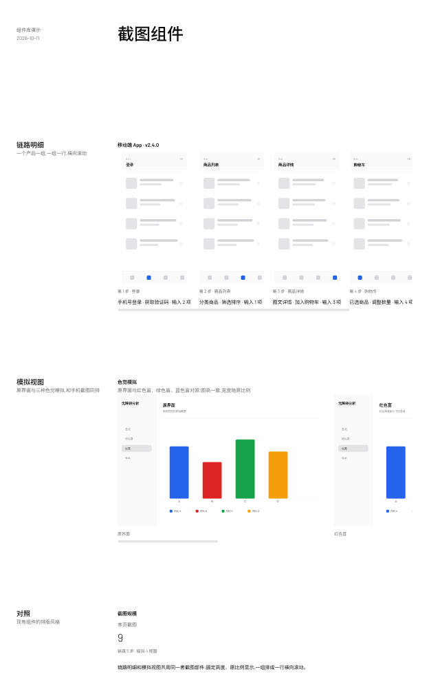

# 组件改动 k1(待审,第 3 版)

组件 Agent 做出的示例,合并前需要人工审批:
- 通过:`node scripts/component-loop.mjs approve k1`
- 写意见让 Agent 再改一版:`node scripts/component-loop.mjs revise k1 "意见"`
- 自己改代码:直接改 `traces/_components/k1/app/`,改完再 approve
- 不采用:`node scripts/component-loop.mjs reject k1 "原因"`

## 示例效果

演示页用组件 Agent 自造的测试数据,新部件和一小段现有组件放在同一页:



切块截图在 `traces/_components/k1/tile-*.png`。

## 组件 Agent 的说明

修好了。问题出在新增的 `app/src/components/ui/scroll-area.tsx` 第 20 行:视口类名里带了 `transition-[color,box-shadow]` 和 `focus-visible:ring-[3px]`,既是阴影也违反「不加装饰」的规范。

**改动**

`app/src/components/ui/scroll-area.tsx` 视口改为只保留布局和焦点语义,去掉所有 shadow/ring:

```tsx
className="size-full rounded-[inherit] outline-none"
```

其余部件(滚动条、Corner、`FigureStrip` 组合)不动,横向滚动和裁切行为保持原样。演示页 `Page.tsx` 程序检查本来就是 `[]`,无需改动。

**复跑结果**

```
程序检查全部通过。
截图:thumb.png、tile-1.png、tile-2.png、tile-3.png、tile-4.png
```

`checks.json` 现为 `[]`,组件代码检查里那条 shadow 告警已消除。截图确认:链路明细一行 5 步截图按同一高度、原比例排开,超出宽度由 shadcn 滚动条承接;模拟视图四张(原界面 + 红/绿/蓝)对照正常,整页无卡片、无底色、无阴影。

## 需求(Maintainer 归纳的「组件不够」问题,2 条)

- **交互流程挖掘 P-01**(程序检查,f1、f2、f3、f4):链路明细里要展示每一步对应的界面截图,但组件库缺少能放图片/截图的组件,所以无法展示
- **色觉无障碍分析 P-01**(程序检查,c1、c2、c3、c4):报告需要在「模拟视图」一节展示原界面和三种色觉模拟的截图,但组件库缺少能承载图片的组件,所以无法展示

## 检查

演示页程序检查:
无问题

组件代码检查(已有代码和 tokens 不改;新增代码只用 token、规范的字号,无阴影和底色;从 shadcn 复制来的文件也查):
无问题

## 改动

```diff
diff --git a/src/components/report/index.tsx b/src/components/report/index.tsx
index de79a21..1a98524 100644
--- a/src/components/report/index.tsx
+++ b/src/components/report/index.tsx
@@ -7,6 +7,7 @@
 import * as React from "react"
 
 import { cn } from "@/lib/utils"
+import { ScrollArea, ScrollBar } from "@/components/ui/scroll-area"
 import { Node, type SpecNode } from "./render"
 
 const SPAN = ["", "col-span-1", "col-span-2", "col-span-3", "col-span-4", "col-span-5", "col-span-6", "col-span-7", "col-span-8", "col-span-9", "col-span-10", "col-span-11", "col-span-12"]
@@ -89,3 +90,36 @@ export const KV = content("kv")
 export function Text({ children, className, span }: Placed & { children: string }) {
   return <Node node={{ type: "text", text: children, className }} ctx={{ span }} />
 }
+
+// Screenshots: one screen per Figure, laid out in a FigureStrip that scrolls
+// sideways on a shadcn ScrollArea. Every image is drawn at the same height and
+// keeps its own width, so phone screenshots and wider analysis screenshots line
+// up in one row without being cropped; anything past the right edge is clipped
+// and reached with the scrollbar.
+export function FigureStrip({ className, children, ...props }: React.ComponentProps<typeof ScrollArea>) {
+  return (
+    <ScrollArea data-slot="figure-strip" type="always" className={cn("w-full min-w-0", className)} {...props}>
+      <div className="flex w-max gap-6 pb-4">{children}</div>
+      <ScrollBar orientation="horizontal" />
+    </ScrollArea>
+  )
+}
+
+export function Figure({ className, ...props }: React.ComponentProps<"figure">) {
+  return <figure data-slot="figure" className={cn("flex shrink-0 flex-col gap-2", className)} {...props} />
+}
+
+// The image keeps its own ratio at the strip's height, so nothing is cropped.
+export function FigureImage({ className, ...props }: React.ComponentProps<"img">) {
+  return 
+}
+
+// The screen or view name, on the line the design gives 12px notes.
+export function FigureLabel({ className, ...props }: React.ComponentProps<"figcaption">) {
+  return <figcaption data-slot="figure-label" className={cn("text-xs leading-6 text-muted-foreground", className)} {...props} />
+}
+
+// What happens on the screen (content, action, fields), in body type.
+export function FigureText({ className, ...props }: React.ComponentProps<"div">) {
+  return <div data-slot="figure-text" className={cn("text-sm leading-6", className)} {...props} />
+}
diff --git a/src/components/ui/aspect-ratio.tsx b/src/components/ui/aspect-ratio.tsx
new file mode 100644
index 0000000..ecf43ba
--- /dev/null
+++ b/src/components/ui/aspect-ratio.tsx
@@ -0,0 +1,12 @@
+"use client"
+
+import * as React from "react"
+import { AspectRatio as AspectRatioPrimitive } from "radix-ui"
+
+function AspectRatio({
+  ...props
+}: React.ComponentProps<typeof AspectRatioPrimitive.Root>) {
+  return <AspectRatioPrimitive.Root data-slot="aspect-ratio" {...props} />
+}
+
+export { AspectRatio }
diff --git a/src/components/ui/scroll-area.tsx b/src/components/ui/scroll-area.tsx
new file mode 100644
index 0000000..737d492
--- /dev/null
+++ b/src/components/ui/scroll-area.tsx
@@ -0,0 +1,57 @@
+"use client"
+
+import * as React from "react"
+import { cn } from "@/lib/utils"
+import { ScrollArea as ScrollAreaPrimitive } from "radix-ui"
+
+function ScrollArea({
+  className,
+  children,
+  ...props
+}: React.ComponentProps<typeof ScrollAreaPrimitive.Root>) {
+  return (
+    <ScrollAreaPrimitive.Root
+      data-slot="scroll-area"
+      className={cn("relative", className)}
+      {...props}
+    >
+      <ScrollAreaPrimitive.Viewport
+        data-slot="scroll-area-viewport"
+        className="size-full rounded-[inherit] outline-none"
+      >
+        {children}
+      </ScrollAreaPrimitive.Viewport>
+      <ScrollBar />
+      <ScrollAreaPrimitive.Corner />
+    </ScrollAreaPrimitive.Root>
+  )
+}
+
+function ScrollBar({
+  className,
+  orientation = "vertical",
+  ...props
+}: React.ComponentProps<typeof ScrollAreaPrimitive.ScrollAreaScrollbar>) {
+  return (
+    <ScrollAreaPrimitive.ScrollAreaScrollbar
+      data-slot="scroll-area-scrollbar"
+      orientation={orientation}
+      className={cn(
+        "flex touch-none p-px transition-colors select-none",
+        orientation === "vertical" &&
+          "h-full w-2.5 border-l border-l-transparent",
+        orientation === "horizontal" &&
+          "h-2.5 flex-col border-t border-t-transparent",
+        className
+      )}
+      {...props}
+    >
+      <ScrollAreaPrimitive.ScrollAreaThumb
+        data-slot="scroll-area-thumb"
+        className="relative flex-1 rounded-full bg-border"
+      />
+    </ScrollAreaPrimitive.ScrollAreaScrollbar>
+  )
+}
+
+export { ScrollArea, ScrollBar }
diff --git a/components.md b/traces/_components/k1/components.md
index aa3b38f..0a515a6 100644
--- a/components.md
+++ b/traces/_components/k1/components.md
@@ -4,7 +4,7 @@
 
 ```tsx
 import data from "./data.json"
-import { Page, Section, Group, Grid, Block, Text, Stat, DataTable, TrendChart, BarChart, ProgressList, List, KV } from "@/components/report"
+import { Page, Section, Group, Grid, Block, Text, Stat, DataTable, TrendChart, BarChart, ProgressList, List, KV, FigureStrip, Figure, FigureImage, FigureLabel, FigureText } from "@/components/report"
 ```
 
 不直接写 HTML 标签(`<div>` 除外,也尽量不用),不写 `style`,不写颜色类名和任意值类名(如 `text-[13px]`)。字号、颜色、间距都由组件给出;规范允许的类名只有 design.md 里写明的几个。
@@ -35,3 +35,46 @@ import { Page, Section, Group, Grid, Block, Text, Stat, DataTable, TrendChart, B
 | `ProgressList` | `items: {label, value, max?, display?}[]`, `compact?` | 进度条列表;`compact` 每行依次是名称、细条、数值 |
 | `List` | `items: {title?, description?, meta?}[]`, `numbered?`, `ordered?`, `columns?`, `divided?`, `metaTone?: "destructive"` | 列表。`numbered` 带 01、02 序号和行间细线;`columns` 并排;`ordered` 带 1、2 序号 |
 | `KV` | `items: {label, value}[]`, `labelCols?` | 键值表;`labelCols` 让标签占几列网格 |
+
+## 截图
+
+一组可组合的部件,用来放界面截图(链路里的一格一屏、模拟视图的一组四张)。放在 `FigureStrip` 里,一格就是一个 `Figure`;图、标签、说明的上下顺序由页面决定。
+
+| 组件 | props | 说明 |
+|---|---|---|
+| `FigureStrip` | children | 一行截图,放在 shadcn `ScrollArea` 里横向滚动,滚动条是 shadcn 的样式(不是浏览器原生滚动条);超出宽度的部分裁掉,不把页面撑宽 |
+| `Figure` | children | 一张截图的外框,纵向排图、标签和说明;宽度随图,不收缩 |
+| `FigureImage` | `src`, `alt` | 截图本体。固定高度、按原比例显示,不裁剪,所以不用传比例 |
+| `FigureLabel` | children(字符串) | 图下面或上面的视图名(屏名、步号),12px 灰色 |
+| `FigureText` | children(字符串) | 图下面的说明(内容、操作、输入项),14px 正文 |
+
+链路明细:一个产品一组,一组一行,按步骤顺序横向排开。图高一致,不同比例的截图(手机 375×760、分析图 1200×760)也能并排对齐。
+
+```tsx
+<Group title={`${chain.product} · ${chain.version}`}>
+  <FigureStrip>
+    {chain.steps.map((step) => (
+      <Figure key={step.no}>
+        <FigureImage src={step.image} alt={`${chain.product} 第 ${step.no} 步:${step.screen}`} />
+        <FigureLabel>第 {step.no} 步 · {step.screen}</FigureLabel>
+        <FigureText>{step.content} · {step.action} · 输入 {step.inputs} 项</FigureText>
+      </Figure>
+    ))}
+  </FigureStrip>
+</Group>
+```
+
+模拟视图:一组四张(原界面 + 三种色觉模拟),每张带视图名,横向排开;要放说明文字就用 `Block` 的 `title`/`description` 包住这一组。`FigureLabel` 放在 `FigureImage` 前就是名称在上,放在后就是名称在下。
+
+```tsx
+<Block title="色觉模拟" description="原界面与红色盲、绿色盲、蓝色盲模拟对照">
+  <FigureStrip>
+    {views.map((view) => (
+      <Figure key={view.name}>
+        <FigureImage src={view.image} alt={view.name} />
+        <FigureLabel>{view.name}</FigureLabel>
+      </Figure>
+    ))}
+  </FigureStrip>
+</Block>
+```

```
