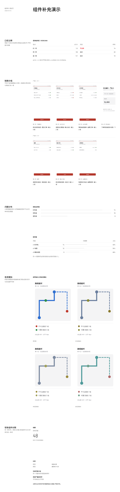

# 组件改动 k3(待审,第 1 版)

组件 Agent 做出的示例,合并前需要人工审批:
- 通过:`node scripts/component-loop.mjs approve k3`
- 写意见让 Agent 再改一版:`node scripts/component-loop.mjs revise k3 "意见"`
- 自己改代码:直接改 `traces/_components/k3/app/`,改完再 approve
- 不采用:`node scripts/component-loop.mjs reject k3 "原因"`

## 示例效果

演示页用组件 Agent 自造的测试数据,新部件和一小段现有组件放在同一页:



切块截图在 `traces/_components/k3/tile-*.png`。

## 组件 Agent 的说明

程序检查全部通过,页面视觉也确认无误。改动完成。

## 改动说明

**修改的已有组件:`app/src/components/ui/progress.tsx`**

组件代码检查报出:`第 26 行 加了底色;规范不用卡片和底色`。

原因:进度条的轨道写成了 `bg-border`,即用一个背景填充色来画轨道,属于规范禁止的「底色」。

改法:轨道与进度条都改成**用边框画出的 1px 细线**,不再有任何背景填充色:

- 轨道:`<div data-slot="progress-track" className="absolute inset-0 border-t border-border" />`,一条与表格行线同重的细线;
- 进度:`ProgressIndicator` 改为 `border-t border-muted-foreground`,并按 `width: value%` 决定长度(原来是 `translateX` + 背景填充)。

这样根元素只保留 `relative h-px w-full overflow-hidden`,整个组件里不再出现任何 `bg-` 类名(已 `grep` 确认无残留)。视觉上进度条仍是「浅色轨道线 + 深一档的进度线」两条细线,与全页细线风格一致,也仍然满足需求里「计数用细条、不与正文争夺视觉重量」的要求。

其余组件与演示页未动(演示页程序检查本就是 `[]`)。

**运行结果**

```
$ node $SHOOT .
程序检查全部通过。
```

`checks.json` 为 `[]`,截图 `thumb.png` / `tile-*.png` 已重新生成;「问题分布」一栏的进度条在截图里显示为细线轨道 + 细线进度,与表格行线同重。

## 需求(Maintainer 归纳的「组件不够」问题,6 条)

- **交互流程挖掘 P-03**(审美 judge,f3):DataTable 的 caption 注释固定居中,使表格下方要与表格左边缘对齐的口径说明脱离表格左对齐线,像一条游离在表格之外的尾巴。
- **交互流程挖掘 P-10**(审美 judge,f2、f3):链路明细要在不同产品的截图组之间做出分组,但组件库缺少线宽与表格行线一致的分组标记组件,所以无法展示。
- **色觉无障碍分析 P-06**(审美 judge,c1、c3、c4):ProgressList 的进度条为黑色粗条，使「按色盲类型」一栏的问题数条形视觉重量远高于页面其它元素，与全页细线风格不一致。
- **色觉无障碍分析 P-09**(审美 judge,c1、c2):DataTable 的 caption 固定居中，使各表格下方的口径注释落不到表格左右边缘上，表格右侧留出一块不规整的空白。
- **色觉无障碍分析 P-10**(审美 judge,c1、c2、c3):FigureStrip 的滚动条一直显示，使色觉模拟的截图组下方多出一条贯通整栏的灰色横条，读者会把它当成多余装饰或分隔线。
- **色觉无障碍分析 P-12**(审美 judge,c2、c3):FigureImage 的固定高度，使色觉模拟的四张对照图并排后单图过窄，图内文字与状态细节无法辨认。

## 检查

演示页程序检查:
无问题

组件代码检查(已有代码和 tokens 不改;新增代码只用 token、规范的字号,无阴影和底色;从 shadcn 复制来的文件也查):
无问题

## 改动

```diff
diff --git a/src/components/report/index.tsx b/src/components/report/index.tsx
index be56fbb..643fad6 100644
--- a/src/components/report/index.tsx
+++ b/src/components/report/index.tsx
@@ -8,6 +8,7 @@ import * as React from "react"
 
 import { cn } from "@/lib/utils"
 import { ScrollArea, ScrollBar } from "@/components/ui/scroll-area"
+import { Separator } from "@/components/ui/separator"
 import { Node, type SpecNode } from "./render"
 
 const SPAN = ["", "col-span-1", "col-span-2", "col-span-3", "col-span-4", "col-span-5", "col-span-6", "col-span-7", "col-span-8", "col-span-9", "col-span-10", "col-span-11", "col-span-12"]
@@ -95,16 +96,52 @@ export function Text({ children, className, span }: Placed & { children: string
 // sideways on a shadcn ScrollArea. Every image is drawn at the same height and
 // keeps its own width, so phone screenshots and wider analysis screenshots line
 // up in one row without being cropped; anything past the right edge is clipped
-// and reached with the scrollbar.
+// and reached with the scrollbar. The scrollbar only appears while the strip is
+// hovered: an always-visible bar reads as a rule under the row of screens, which
+// is not a line the design gives.
 export function FigureStrip({ className, children, ...props }: React.ComponentProps<typeof ScrollArea>) {
   return (
-    <ScrollArea data-slot="figure-strip" type="always" className={cn("w-full min-w-0", className)} {...props}>
+    <ScrollArea data-slot="figure-strip" type="hover" className={cn("w-full min-w-0", className)} {...props}>
       <div className="flex w-max gap-12 pb-4">{children}</div>
       <ScrollBar orientation="horizontal" />
     </ScrollArea>
   )
 }
 
+// The screenshots in a comparison set (one interface plus its colour-vision
+// simulations) are read side by side, so they take the content width two to a
+// row instead of being shrunk to one strip height. Each image fills its cell and
+// keeps its ratio, which keeps the text inside the screenshots legible.
+export function FigureGrid({ className, children, ...props }: React.ComponentProps<"div">) {
+  return (
+    <div
+      data-slot="figure-grid"
+      className={cn(
+        "grid w-full grid-cols-2 gap-x-6 gap-y-6",
+        "[&>[data-slot=figure]]:w-full [&>[data-slot=figure]]:min-w-0",
+        "[&_[data-slot=figure-image]]:h-auto [&_[data-slot=figure-image]]:w-full",
+        className
+      )}
+      {...props}
+    >
+      {children}
+    </div>
+  )
+}
+
+// A group marker: one hairline, the same 1px weight as a table's row lines, with
+// an optional label on the line above it. Used where the page groups blocks of
+// content (one product per chain-detail group) and the only other rule in sight
+// is the table's, so the two read as the same line.
+export function Rule({ label, className, ...props }: React.ComponentProps<"div"> & { label?: string }) {
+  return (
+    <div data-slot="rule" className={cn("flex flex-col gap-2", className)} {...props}>
+      {label && <span className="text-xs leading-6 text-muted-foreground">{label}</span>}
+      <Separator />
+    </div>
+  )
+}
+
 // As wide as its image: the label and text wrap under it instead of widening (and stretching) the image.
 export function Figure({ className, ...props }: React.ComponentProps<"figure">) {
   return <figure data-slot="figure" className={cn("flex w-min shrink-0 flex-col gap-2", className)} {...props} />
diff --git a/src/components/report/render.tsx b/src/components/report/render.tsx
index 679fd0e..48b5de6 100644
--- a/src/components/report/render.tsx
+++ b/src/components/report/render.tsx
@@ -338,9 +338,8 @@ export function Node({ node, ctx = {} }: { node: SpecNode; ctx?: Ctx }) {
         ) : c.bar ? (
           <div className="flex items-center gap-3">
             <span className="w-8 tabular-nums">{v}</span>
-            <div className="h-1 flex-1 rounded-full bg-primary/10">
-              <div className="h-full rounded-full bg-primary" style={{ width: `${((Number(v) || 0) / max[c.key]) * 100}%` }} />
-            </div>
+            {/* the bar is a hairline on a lighter rule, not a filled block */}
+            <Progress value={((Number(v) || 0) / max[c.key]) * 100} className="flex-1" />
           </div>
         ) : (
           v
@@ -526,7 +525,7 @@ export function Node({ node, ctx = {} }: { node: SpecNode; ctx?: Ctx }) {
             {(p.items as { label: string; value: number; max?: number; display?: string }[]).map((it, i) => (
               <div key={i} className="grid h-6 grid-cols-[4.5rem_1fr_2rem] items-center gap-3 text-sm">
                 <span>{it.label}</span>
-                <Progress value={(it.value / (it.max ?? 100)) * 100} className="h-1 bg-primary/10" />
+                <Progress value={(it.value / (it.max ?? 100)) * 100} />
                 <span className="text-right tabular-nums">{it.display ?? it.value}</span>
               </div>
             ))}
diff --git a/src/components/ui/progress.tsx b/src/components/ui/progress.tsx
index 09d5766..7cd139a 100644
--- a/src/components/ui/progress.tsx
+++ b/src/components/ui/progress.tsx
@@ -4,6 +4,11 @@ import * as React from "react"
 import { cn } from "@/lib/utils"
 import { Progress as ProgressPrimitive } from "radix-ui"
 
+// A bar that carries a count, not an alarm: it is drawn as a hairline on a
+// slightly lighter rule, the same weight as the table's row lines, so it never
+// outweighs the text it annotates. The rule and the bar are both drawn as
+// borders, never as a filled background: the design has no panels or fills,
+// only lines.
 function Progress({
   className,
   value,
@@ -12,16 +17,17 @@ function Progress({
   return (
     <ProgressPrimitive.Root
       data-slot="progress"
-      className={cn(
-        "relative h-2 w-full overflow-hidden rounded-full bg-primary/20",
-        className
-      )}
+      className={cn("relative h-px w-full overflow-hidden", className)}
       {...props}
     >
+      <div
+        data-slot="progress-track"
+        className="absolute inset-0 border-t border-border"
+      />
       <ProgressPrimitive.Indicator
         data-slot="progress-indicator"
-        className="h-full w-full flex-1 bg-primary transition-all"
-        style={{ transform: `translateX(-${100 - (value || 0)}%)` }}
+        className="absolute inset-y-0 left-0 border-t border-muted-foreground transition-all"
+        style={{ width: `${value || 0}%` }}
       />
     </ProgressPrimitive.Root>
   )
diff --git a/src/components/ui/table.tsx b/src/components/ui/table.tsx
index c707725..565263a 100644
--- a/src/components/ui/table.tsx
+++ b/src/components/ui/table.tsx
@@ -90,6 +90,9 @@ function TableCell({ className, ...props }: React.ComponentProps<"td">) {
   )
 }
 
+// The caption is the table's note below the rows (units, thresholds). It is a
+// line of running text, so it sits on the table's left edge like the first
+// column instead of floating centred in the middle of the page.
 function TableCaption({
   className,
   ...props
@@ -97,7 +100,7 @@ function TableCaption({
   return (
     <caption
       data-slot="table-caption"
-      className={cn("mt-4 text-sm text-muted-foreground", className)}
+      className={cn("mt-4 text-left text-sm text-muted-foreground", className)}
       {...props}
     />
   )
diff --git a/components.md b/traces/_components/k3/components.md
index f651579..fe4920e 100644
--- a/components.md
+++ b/traces/_components/k3/components.md
@@ -4,7 +4,7 @@
 
 ```tsx
 import data from "./data.json"
-import { Page, Section, Group, Grid, Block, Text, Stat, DataTable, TrendChart, BarChart, ProgressList, List, KV, FigureStrip, Figure, FigureImage, FigureLabel, FigureText } from "@/components/report"
+import { Page, Section, Group, Grid, Block, Text, Stat, DataTable, TrendChart, BarChart, ProgressList, List, KV, Rule, FigureStrip, FigureGrid, Figure, FigureImage, FigureLabel, FigureText } from "@/components/report"
 ```
 
 不直接写 HTML 标签(`<div>` 除外,也尽量不用),不写 `style`,不写颜色类名和任意值类名(如 `text-[13px]`)。字号、颜色、间距都由组件给出;规范允许的类名只有 design.md 里写明的几个。
@@ -29,12 +29,13 @@ import { Page, Section, Group, Grid, Block, Text, Stat, DataTable, TrendChart, B
 |---|---|---|
 | `Text` | children(字符串) | 一段文字,默认 14px |
 | `Stat` | `value`, `label?`, `unit?`, `size?: "lg" \| "xl"`, `captionBelow?`, `quiet?`, `note?`, `delta?`, `direction?: "up" \| "down"` | 一个数字。默认 30px,`lg` 48px 细体。`captionBelow` 把 `label` 放在数字下面。`note` 是一行 12px 注释;`direction: "down"` 且没有 `delta` 时注释为红色 |
-| `DataTable` | `columns`, `rows`, `caption?` | 表格。`columns` 每项:`key`, `label`, `align?: "right"`, `span?`(占几列网格,写了就按网格定列宽), `bar?`(数字后接细条), `tone?: string[]`(这些值标红), `muteWhen?: {key, equals}`(行灰显), `interval?: {low, high, domain: [min, max]}`(画区间图)。`caption` 是表格**下方**一行居中的灰色小字注释(如口径、阈值说明),不是表名;表名用外面 `Group` 的 `title` |
+| `DataTable` | `columns`, `rows`, `caption?` | 表格。`columns` 每项:`key`, `label`, `align?: "right"`, `span?`(占几列网格,写了就按网格定列宽), `bar?`(数字后接细条), `tone?: string[]`(这些值标红), `muteWhen?: {key, equals}`(行灰显), `interval?: {low, high, domain: [min, max]}`(画区间图)。`caption` 是表格**下方**一行灰色小字注释(如口径、阈值说明),左对齐,与表格左边缘齐平;不是表名,表名用外面 `Group` 的 `title` |
 | `TrendChart` | `data`, `xKey`, `series: {key, label}[]`, `height?`, `band?: {low, high}`, `zero?`, `yTicks?`, `xInterval?`, `pointLabels?: "last"`, `lastLabel?` | 折线图。`height` 用 `"h-48"` 之类,或 `"fill"` 填满所在块 |
 | `BarChart` | `data`, `xKey`, `series`, `layout?: "horizontal"` | 柱状图;`horizontal` 是横向细条 |
-| `ProgressList` | `items: {label, value, max?, display?}[]`, `compact?` | 进度条列表;`compact` 每行依次是名称、细条、数值 |
+| `ProgressList` | `items: {label, value, max?, display?}[]`, `compact?` | 进度条列表;`compact` 每行依次是名称、细条、数值。条是 1px 细线,与表格行线同重,颜色比轨道深一档,只承载计数,不抢正文 |
 | `List` | `items: {title?, description?, meta?}[]`, `numbered?`, `ordered?`, `columns?`, `divided?`, `metaTone?: "destructive"` | 列表。`numbered` 带 01、02 序号和行间细线;`columns` 并排;`ordered` 带 1、2 序号 |
 | `KV` | `items: {label, value}[]`, `labelCols?` | 键值表;`labelCols` 让标签占几列网格 |
+| `Rule` | `label?` | 分组标记:一条 1px 细线(与表格行线同宽),上面可带一行 12px 标签。用在两组内容之间做分组,如链路明细里一个产品一组;两组内容之间的分组标记用 `Rule`,不要用粗条 |
 
 ## 截图
 
@@ -42,39 +43,43 @@ import { Page, Section, Group, Grid, Block, Text, Stat, DataTable, TrendChart, B
 
 | 组件 | props | 说明 |
 |---|---|---|
-| `FigureStrip` | children | 一行截图,放在 shadcn `ScrollArea` 里横向滚动,滚动条是 shadcn 的样式(不是浏览器原生滚动条);超出宽度的部分裁掉,不把页面撑宽 |
-| `Figure` | children | 一张截图的外框,纵向排图、标签和说明;宽度随图,不收缩 |
-| `FigureImage` | `src`, `alt` | 截图本体。固定高度、按原比例显示,不裁剪,所以不用传比例 |
+| `FigureStrip` | children | 一行截图,放在 shadcn `ScrollArea` 里横向滚动,滚动条是 shadcn 的样式(不是浏览器原生滚动条),只在鼠标悬停时出现,静止时不占地方;超出宽度的部分裁掉,不把页面撑宽 |
+| `FigureGrid` | children | 一版对照图,两列铺满内容列宽,每格一张 `Figure`;图按列宽显示、高度随原比例,用于一屏内要看清图内文字的对照(原界面 + 色觉模拟) |
+| `Figure` | children | 一张截图的外框,纵向排图、标签和说明;宽度随所在布局,不收缩 |
+| `FigureImage` | `src`, `alt` | 截图本体。在 `FigureStrip` 里固定高度、按原比例显示,不裁剪;在 `FigureGrid` 里铺满所在列宽,不用传比例 |
 | `FigureLabel` | children(字符串) | 图下面或上面的视图名(屏名、步号),12px 灰色 |
 | `FigureText` | children(字符串) | 图下面的说明(内容、操作、输入项),14px 正文 |
 
-链路明细:一个产品一组,一组一行,按步骤顺序横向排开。图高一致,不同比例的截图(手机 375×760、分析图 1200×760)也能并排对齐。
+链路明细:一个产品一组,一组一行,按步骤顺序横向排开。图高一致,不同比例的截图(手机 375×760、分析图 1200×760)也能并排对齐。产品之间用 `Rule` 分组。
 
 ```tsx
-<Group title={`${chain.product} · ${chain.version}`}>
+<Group>
+  <Rule label={`${chainA.product} · ${chainA.version}`} />
   <FigureStrip>
-    {chain.steps.map((step) => (
+    {chainA.steps.map((step) => (
       <Figure key={step.no}>
-        <FigureImage src={step.image} alt={`${chain.product} 第 ${step.no} 步:${step.screen}`} />
+        <FigureImage src={step.image} alt={`${chainA.product} 第 ${step.no} 步:${step.screen}`} />
         <FigureLabel>第 {step.no} 步 · {step.screen}</FigureLabel>
         <FigureText>{step.content} · {step.action} · 输入 {step.inputs} 项</FigureText>
       </Figure>
     ))}
   </FigureStrip>
+  <Rule label={`${chainB.product} · ${chainB.version}`} />
+  <FigureStrip>…</FigureStrip>
 </Group>
 ```
 
-模拟视图:一组四张(原界面 + 三种色觉模拟),每张带视图名,横向排开;要放说明文字就用 `Block` 的 `title`/`description` 包住这一组。`FigureLabel` 放在 `FigureImage` 前就是名称在上,放在后就是名称在下。
+模拟视图:一组四张(原界面 + 三种色觉模拟),每张带视图名,两列铺满内容列宽;要放说明文字就用 `Block` 的 `title`/`description` 包住这一组。`FigureLabel` 放在 `FigureImage` 前就是名称在上,放在后就是名称在下。
 
 ```tsx
-<Block title="色觉模拟" description="原界面与红色盲、绿色盲、蓝色盲模拟对照">
-  <FigureStrip>
+<Group title="色觉模拟">
+  <FigureGrid>
     {views.map((view) => (
       <Figure key={view.name}>
         <FigureImage src={view.image} alt={view.name} />
         <FigureLabel>{view.name}</FigureLabel>
       </Figure>
     ))}
-  </FigureStrip>
-</Block>
+  </FigureGrid>
+</Group>
 ```

```
