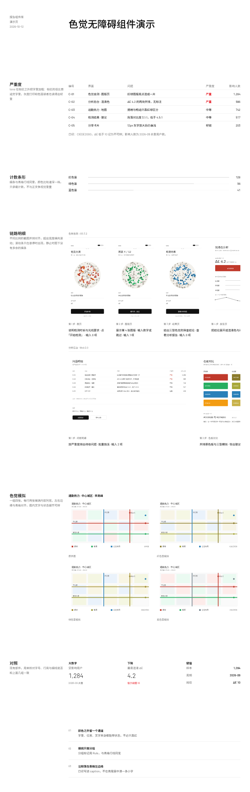

# 组件改动 k4(待审,第 1 版)

组件 Agent 做出的示例,合并前需要人工审批:
- 通过:`node scripts/component-loop.mjs approve k4`
- 写意见让 Agent 再改一版:`node scripts/component-loop.mjs revise k4 "意见"`
- 自己改代码:直接改 `traces/_components/k4/app/`,改完再 approve
- 不采用:`node scripts/component-loop.mjs reject k4 "原因"`

## 示例效果

演示页用组件 Agent 自造的测试数据,新部件和一小段现有组件放在同一页:



切块截图在 `traces/_components/k4/tile-*.png`。

## 组件 Agent 的说明

全部完成,检查通过(`checks.json` 为 `[]`)。下面是说明。

## 交付物

| 文件 | 内容 |
|---|---|
| `Page.tsx` | 演示页,五节对应五条需求 + 一节现有部件对照 |
| `assets/*.svg`(11 张) | 手机屏 375×760 ×4、分析屏 1200×760 ×3、色觉模拟 640×400 ×4 |
| `tools/gen-assets.mjs` | 生成上面这些图的脚本(尺寸、色觉模拟的配色都在里面) |
| `components.md` | 补上了 `tone` 的第二通道、`FigureStrip` 行高归属、`FigureImage` 的定尺规则 |
| `app/src/components/report/{index.tsx,render.tsx}` | 本轮改动的两个文件(见下) |

## 新部件叫什么、各管什么、来自哪里

本轮**没有新增部件**——五条需求都是已有部件的行为问题,按「能改就不新增」处理。改的是两个已有文件里的五处:

| 部件 | 管什么 | 来源 | 改了什么 |
|---|---|---|---|
| `DataTable` 的 `tone` | 状态值(如「严重」) | shadcn `Table` | 标红 + `font-medium` → **标红 + `font-semibold`(400→600)** |
| `ProgressList`(`compact`) | 一行:名称、细条、数值 | shadcn `Progress`(Radix Progress) | 标签列 `4.5rem/gap-3` → **`74px/gap-6`**,条从网格列线起 |
| `FigureStrip` | 一行截图,横向滚动 | shadcn `ScrollArea`(Radix ScrollArea) | 行高**由条自己定**:行容器加 `[&_[data-slot=figure-image]]:h-96 …w-auto`;`type="hover"` 保留 |
| `FigureGrid` | 一组对照图,两列铺满列宽 | 组合部件(无原语) | 删掉对图片的覆盖,只留 `[&>[data-slot=figure]]:w-full min-w-0` |
| `FigureImage` | 截图本体 | 组合部件(``) | 去掉固定高度 `h-96`,改成 `block w-full max-w-none` |
| `Rule` / `FigureLabel` / `FigureText` / `Figure` | 分组线、视图名、说明、外框 | `Rule` 来自 shadcn `Separator`(Radix Separator) | 未动 |

关键一处:原来 `FigureImage` 自带 384px 固定高度,`FigureGrid` 只能用后代选择器把它**覆盖**掉。现在把「行高」还给真正拥有它的 `FigureStrip`——条负责统一行高,网格负责列宽,叶子部件不再定尺,`FigureGrid` 的覆盖也就删掉了。

## 怎么组合(最小示例)

```tsx
<Group>
  <DataTable columns={[{ key: "severity", label: "严重度", span: 1, tone: ["严重"] }, …]}
             rows={rows} caption="口径:CIEDE2000,ΔE 低于 10 记为不可辨。" />
</Group>
<ProgressList compact items={[{ label: "红色盲", value: 128, max: 128 }]} />
<Rule label="色觉自测 · iOS 3.2" />
<FigureStrip>
  <Figure><FigureImage src="assets/phone-home.svg" alt="首页" />
    <FigureLabel>第 1 步 · 首页</FigureLabel><FigureText>…</FigureText></Figure>
</FigureStrip>
<FigureGrid>{views.map((v) => <Figure key={v.name}><FigureImage src={v.image} alt={v.name} /><FigureLabel>{v.name}</FigureLabel></Figure>)}</FigureGrid>
```

## 需求逐条

| 需求 | 结果 |
|---|---|
| tone 只有颜色一个通道 | **做了**。`font-semibold`,与正文 400 差两档。灰度核对过:`font-medium` 时「严重」比「中等」还浅、粗细几乎一样;改 600 后笔画明显更重 |
| ProgressList 黑粗条 | **做了**。条是 `Progress` 的 1px 细线(与表格行线同重),颜色比轨道深一档;实测 `height: 1px` |
| caption 居中 | **做了**。`TableCaption` 左对齐;实测 caption 与表格左边缘同为 x=438 |
| FigureStrip 滚动条常显 | **做了**。`ScrollArea type="hover"`;实测静止时页面上 `[data-slot=scroll-area-scrollbar]` 数量为 **0**(Radix 悬停才挂载),截图行静止时图下没有横条 |
| FigureImage 固定高度 | **做了**。定尺移出叶子部件;实测截图行所有图 **h=384**,宽 189(手机)/606(宽屏)并排;对照网格两列各 417px,图 417×261 铺满列宽 |

## 没做的,及原因

- **P-06 的「刻度或数值基准」**:没加刻度轴。每行的数值已经写在行尾(数值基准有了),再加一套坐标会在 858px 内容列里多一层尺子,与全页「细线只做分组」的写法冲突;这一栏是计数不是比例尺。条与相邻表格共用对齐线这一条做了(条起点 x=536,正好是表格「界面」列线)。
- **P-16 的「标记」那一路**:没加图形标记(▲/● 之类)。规范里装饰只有细线、不加底色和标签;字重已经构成第二通道,再加标记会和「严重」这两个字本身重复。
- **没新增部件**:五条需求都能落在已有部件上,没有出现「缺一个部件」的情况。

## 验证

- `node $SHOOT .` 程序检查全部通过(0 findings)。
- 除截图外还量了 DOM:表格/内容列 858px、caption 对齐、条 1px、截图行 `scrollWidth` 1319 与 1498(>858,所以悬停才有条)、网格 417px 两列、tone 600 对普通 400。
- 灰度核对是把截图裁切放大后加 `grayscale(1)` 比的;这一步的临时脚本用完已删,只留 `tools/gen-assets.mjs`。

一处提醒:演示页里截图行是有意**裁切**的(超出内容列的图被切掉,靠悬停滚动条去够),这是 `FigureStrip` 的设计;如果希望静止时也看得出「还有内容」,需要另加一个组件能力,本轮没做。

## 需求(Maintainer 归纳的「组件不够」问题,5 条)

- **交互流程挖掘 P-16**(审美 judge,f3、f4):DataTable 的 tone 只改字色、不提供字重或标记,使问题明细表的严重度一列只有颜色一个通道,标红的值与普通文字没有粗细差别,色弱读者和灰度打印读不出轻重。
- **色觉无障碍分析 P-06**(审美 judge,c1、c3、c4):ProgressList 的进度条为黑色粗条，使「按色盲类型」一栏的问题数条形视觉重量远高于页面其它元素，与全页细线风格不一致。
- **色觉无障碍分析 P-09**(审美 judge,c1、c2):DataTable 的 caption 固定居中，使各表格下方的口径注释落不到表格左右边缘上，表格右侧留出一块不规整的空白。
- **色觉无障碍分析 P-10**(审美 judge,c1、c2、c3):FigureStrip 的滚动条一直显示，使色觉模拟的截图组下方多出一条贯通整栏的灰色横条，读者会把它当成多余装饰或分隔线。
- **色觉无障碍分析 P-12**(审美 judge,c2、c3):FigureImage 的固定高度，使色觉模拟的四张对照图并排后单图过窄，图内文字与状态细节无法辨认。

## 检查

演示页程序检查:
无问题

组件代码检查(已有代码和 tokens 不改;新增代码只用 token、规范的字号,无阴影和底色;从 shadcn 复制来的文件也查):
无问题

## 改动

```diff
diff --git a/src/components/report/index.tsx b/src/components/report/index.tsx
index 643fad6..ada85e5 100644
--- a/src/components/report/index.tsx
+++ b/src/components/report/index.tsx
@@ -93,16 +93,25 @@ export function Text({ children, className, span }: Placed & { children: string
 }
 
 // Screenshots: one screen per Figure, laid out in a FigureStrip that scrolls
-// sideways on a shadcn ScrollArea. Every image is drawn at the same height and
-// keeps its own width, so phone screenshots and wider analysis screenshots line
-// up in one row without being cropped; anything past the right edge is clipped
-// and reached with the scrollbar. The scrollbar only appears while the strip is
-// hovered: an always-visible bar reads as a rule under the row of screens, which
-// is not a line the design gives.
+// sideways on a shadcn ScrollArea. The strip is what pins the row height: every
+// image is drawn at that one height and keeps its own width, so phone
+// screenshots and wider analysis screenshots line up in one row without being
+// cropped; anything past the right edge is clipped and reached with the
+// scrollbar. The scrollbar only appears while the strip is hovered: an
+// always-visible bar reads as a rule under the row of screens, which is not a
+// line the design gives.
 export function FigureStrip({ className, children, ...props }: React.ComponentProps<typeof ScrollArea>) {
   return (
     <ScrollArea data-slot="figure-strip" type="hover" className={cn("w-full min-w-0", className)} {...props}>
-      <div className="flex w-max gap-12 pb-4">{children}</div>
+      <div
+        data-slot="figure-strip-row"
+        className={cn(
+          "flex w-max gap-12 pb-4",
+          "[&_[data-slot=figure-image]]:h-96 [&_[data-slot=figure-image]]:w-auto",
+        )}
+      >
+        {children}
+      </div>
       <ScrollBar orientation="horizontal" />
     </ScrollArea>
   )
@@ -119,7 +128,6 @@ export function FigureGrid({ className, children, ...props }: React.ComponentPro
       className={cn(
         "grid w-full grid-cols-2 gap-x-6 gap-y-6",
         "[&>[data-slot=figure]]:w-full [&>[data-slot=figure]]:min-w-0",
-        "[&_[data-slot=figure-image]]:h-auto [&_[data-slot=figure-image]]:w-full",
         className
       )}
       {...props}
@@ -147,9 +155,13 @@ export function Figure({ className, ...props }: React.ComponentProps<"figure">)
   return <figure data-slot="figure" className={cn("flex w-min shrink-0 flex-col gap-2", className)} {...props} />
 }
 
-// The image keeps its own ratio at the strip's height, so nothing is cropped.
+// The image takes the width its cell gives it and keeps its own ratio: nothing
+// is cropped and no height is fixed here. A strip pins the row height (all its
+// images share one height, widths differ); a comparison grid lets the column
+// width decide, so a view read for its detail is never squeezed down to a strip
+// thumbnail.
 export function FigureImage({ className, ...props }: React.ComponentProps<"img">) {
-  return 
+  return 
 }
 
 // The screen or view name, on the line the design gives 12px notes.
diff --git a/src/components/report/render.tsx b/src/components/report/render.tsx
index 48b5de6..a3abb86 100644
--- a/src/components/report/render.tsx
+++ b/src/components/report/render.tsx
@@ -307,7 +307,10 @@ export function Node({ node, ctx = {} }: { node: SpecNode; ctx?: Ctx }) {
 
     case "table": {
       // span: the column's width in grid columns, so cell text starts on a column line.
-      // tone: values listed here are drawn in the destructive colour (a state, e.g. 严重).
+      // tone: values listed here are drawn in the destructive colour (a state, e.g. 严重)
+      // and two weights heavier than the body. Red on its own is a lighter grey than
+      // black in greyscale printing and is invisible to a colour-blind reader, so the
+      // state has to carry a second, non-colour channel: the weight.
       // interval: the cell draws the row's estimate (key) with its range (low..high) on an axis shared by the column.
       // muteWhen: the cell is greyed when the row's field equals the value (e.g. not significant).
       type Col = {
@@ -376,7 +379,9 @@ export function Node({ node, ctx = {} }: { node: SpecNode; ctx?: Ctx }) {
                         // 39px + the 1px row rule = a 40px row
                         onGrid && "h-[39px] py-0 pl-0 pr-6 whitespace-normal",
                         onGrid && i === cols.length - 1 && "pr-0",
-                        c.tone?.includes(String(r[c.key])) && "font-medium text-destructive",
+                        // the state carries weight as well as colour: bolder than the body
+                        // text, so it survives greyscale and colour blindness
+                        c.tone?.includes(String(r[c.key])) && "font-semibold text-destructive",
                         c.muteWhen && r[c.muteWhen.key] === c.muteWhen.equals && "text-muted-foreground/70",
                       )}
                     >
@@ -518,12 +523,14 @@ export function Node({ node, ctx = {} }: { node: SpecNode; ctx?: Ctx }) {
     }
 
     case "progress-list":
-      // compact: one line per item (label, bar, value)
+      // compact: one line per item (label, bar, value). The label column is one grid
+      // column (74px) plus the gutter (24px), so the bar starts on the same column
+      // line as the table next to it instead of on a line of its own.
       if (p.compact)
         return (
           <div {...mark(node)} data-slot="custom-progress-list" className={outer(node, ctx, "flex flex-col gap-2")}>
             {(p.items as { label: string; value: number; max?: number; display?: string }[]).map((it, i) => (
-              <div key={i} className="grid h-6 grid-cols-[4.5rem_1fr_2rem] items-center gap-3 text-sm">
+              <div key={i} className="grid h-6 grid-cols-[74px_1fr_2rem] items-center gap-6 text-sm">
                 <span>{it.label}</span>
                 <Progress value={(it.value / (it.max ?? 100)) * 100} />
                 <span className="text-right tabular-nums">{it.display ?? it.value}</span>
diff --git a/components.md b/traces/_components/k4/components.md
index fe4920e..cdb7e94 100644
--- a/components.md
+++ b/traces/_components/k4/components.md
@@ -29,7 +29,7 @@ import { Page, Section, Group, Grid, Block, Text, Stat, DataTable, TrendChart, B
 |---|---|---|
 | `Text` | children(字符串) | 一段文字,默认 14px |
 | `Stat` | `value`, `label?`, `unit?`, `size?: "lg" \| "xl"`, `captionBelow?`, `quiet?`, `note?`, `delta?`, `direction?: "up" \| "down"` | 一个数字。默认 30px,`lg` 48px 细体。`captionBelow` 把 `label` 放在数字下面。`note` 是一行 12px 注释;`direction: "down"` 且没有 `delta` 时注释为红色 |
-| `DataTable` | `columns`, `rows`, `caption?` | 表格。`columns` 每项:`key`, `label`, `align?: "right"`, `span?`(占几列网格,写了就按网格定列宽), `bar?`(数字后接细条), `tone?: string[]`(这些值标红), `muteWhen?: {key, equals}`(行灰显), `interval?: {low, high, domain: [min, max]}`(画区间图)。`caption` 是表格**下方**一行灰色小字注释(如口径、阈值说明),左对齐,与表格左边缘齐平;不是表名,表名用外面 `Group` 的 `title` |
+| `DataTable` | `columns`, `rows`, `caption?` | 表格。`columns` 每项:`key`, `label`, `align?: "right"`, `span?`(占几列网格,写了就按网格定列宽;一行的 `span` 加起来 9 正好铺满内容列), `bar?`(数字后接细条), `tone?: string[]`(这些值标红**并加粗**(正文 400 → 600)——红色在灰度打印里比黑字还浅,色弱读者也看不出红,所以状态必须有一个颜色之外的通道,字重就是它), `muteWhen?: {key, equals}`(行灰显), `interval?: {low, high, domain: [min, max]}`(画区间图)。`caption` 是表格**下方**一行灰色小字注释(如口径、阈值说明),左对齐,与表格左边缘齐平;不是表名,表名用外面 `Group` 的 `title` |
 | `TrendChart` | `data`, `xKey`, `series: {key, label}[]`, `height?`, `band?: {low, high}`, `zero?`, `yTicks?`, `xInterval?`, `pointLabels?: "last"`, `lastLabel?` | 折线图。`height` 用 `"h-48"` 之类,或 `"fill"` 填满所在块 |
 | `BarChart` | `data`, `xKey`, `series`, `layout?: "horizontal"` | 柱状图;`horizontal` 是横向细条 |
 | `ProgressList` | `items: {label, value, max?, display?}[]`, `compact?` | 进度条列表;`compact` 每行依次是名称、细条、数值。条是 1px 细线,与表格行线同重,颜色比轨道深一档,只承载计数,不抢正文 |
@@ -43,14 +43,14 @@ import { Page, Section, Group, Grid, Block, Text, Stat, DataTable, TrendChart, B
 
 | 组件 | props | 说明 |
 |---|---|---|
-| `FigureStrip` | children | 一行截图,放在 shadcn `ScrollArea` 里横向滚动,滚动条是 shadcn 的样式(不是浏览器原生滚动条),只在鼠标悬停时出现,静止时不占地方;超出宽度的部分裁掉,不把页面撑宽 |
+| `FigureStrip` | children | 一行截图,放在 shadcn `ScrollArea` 里横向滚动,滚动条是 shadcn 的样式(不是浏览器原生滚动条),只在鼠标悬停时出现,静止时不占地方也不画横条;超出宽度的部分裁掉,不把页面撑宽。行高由这条自己定:所有图同高、宽度各按原比例,所以手机 375×760 和分析图 1200×760 能并排对齐 |
 | `FigureGrid` | children | 一版对照图,两列铺满内容列宽,每格一张 `Figure`;图按列宽显示、高度随原比例,用于一屏内要看清图内文字的对照(原界面 + 色觉模拟) |
 | `Figure` | children | 一张截图的外框,纵向排图、标签和说明;宽度随所在布局,不收缩 |
-| `FigureImage` | `src`, `alt` | 截图本体。在 `FigureStrip` 里固定高度、按原比例显示,不裁剪;在 `FigureGrid` 里铺满所在列宽,不用传比例 |
+| `FigureImage` | `src`, `alt` | 截图本体。宽度随所在布局、高度随原比例,**自己不定高**:在 `FigureStrip` 里由条给统一高度(比例不同的图才对得齐),在 `FigureGrid` 里铺满所在列宽(图内文字才看得清)。不裁剪 |
 | `FigureLabel` | children(字符串) | 图下面或上面的视图名(屏名、步号),12px 灰色 |
 | `FigureText` | children(字符串) | 图下面的说明(内容、操作、输入项),14px 正文 |
 
-链路明细:一个产品一组,一组一行,按步骤顺序横向排开。图高一致,不同比例的截图(手机 375×760、分析图 1200×760)也能并排对齐。产品之间用 `Rule` 分组。
+链路明细:一个产品一组,一组一行,按步骤顺序横向排开。图高一致,不同比例的截图(手机 375×760、分析图 1200×760)也能并排对齐;一行放不下就横向滚动,静止时图下不出现横条。产品之间用 `Rule` 分组。
 
 ```tsx
 <Group>

```
