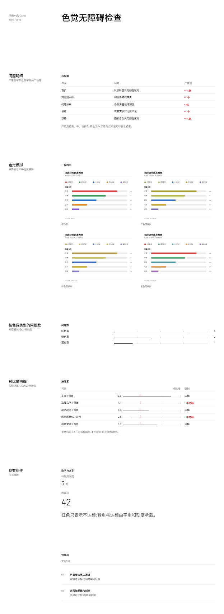

# 组件改动 k5(待审,第 1 版)

组件 Agent 做出的示例,合并前需要人工审批:
- 通过:`node scripts/component-loop.mjs approve k5`
- 写意见让 Agent 再改一版:`node scripts/component-loop.mjs revise k5 "意见"`
- 自己改代码:直接改 `traces/_components/k5/app/`,改完再 approve
- 不采用:`node scripts/component-loop.mjs reject k5 "原因"`

## 示例效果

演示页用组件 Agent 自造的测试数据,新部件和一小段现有组件放在同一页:



切块截图在 `traces/_components/k5/tile-*.png`。

## 组件 Agent 的说明

All checks pass and the page reads correctly. Here is the summary.

## 新部件与改动

**新增:`FigureCompare`(报告部件,`report/index.tsx`)**
- 管什么:一屏内的「一组四张」对照(原界面 + 三种色觉模拟)。两列 2×2,四张图按**同一个固定高度**显示、宽度随原比例,四张都落在同一屏内,图内文字与色差可辨。
- 来源:纯布局部件(和现有 `FigureGrid`/`FigureStrip` 一样是 div 网格,不依赖 Radix);组合方式和它们一致——里面放 `Figure` + `FigureImage` + `FigureLabel`。
- 和 `FigureGrid` 的区别:`FigureGrid` 让图铺满列宽、高度随比例,高图会被推到下一屏;`FigureCompare` 固定高度,所以宽高比不同的四张也能一屏对齐。

**改动:`Progress`(`app/src/components/ui/progress.tsx`,来自 shadcn `progress` / Radix `Progress`)**
- 原来是一条近乎不可见的 1px 细线。现在画出四样东西:轨道(基线)、轨道上的一组刻度线、可选的阈值参考线、以及 2px 前景色的条身。
- 新增 `max`、`ticks`、`threshold` 三个 props(都是数值语义,不是样式开关)。被 `DataTable` 的 `bar` 和 `ProgressList` 共用。
- 为什么:`P-15`(条与轨道不可见、无基线刻度)和 `P-16`(数值条颜色过淡、无阈值线)都落在它身上。

**改动:`DataTable`(`report/render.tsx`)**
- `tone` 从「只标红」改成「按轻重从高到低排列」:命中值同时拿到 **红色 + 字重 600/500/400 + n…1 个点标记**三个通道,灰度打印和色弱读者也能读出轻重顺序(`P-16`)。点标记是 4px 的小圆点,是「标记」不是底色面板。
- `bar` 支持对象 `{max?, threshold?, ticks?}`:条画在带基线的刻度上,并画出阈值参考线,数字与条之间不再留空(`P-16` 对比度一列)。

**改动:`ProgressList`(`report/render.tsx`)**
- 条改按一个**共用刻度**绘制(items 里最大的 max/value),底部有基线、基线上一组刻度线(0、¼、½、¾、1),条身墨色比轨道深两档;`compact` 行改用 9 列网格(名称 3 列、条+数值 6 列),条从表格第 2 列所在的网格线起画,和相邻表格**共用对齐线**(`P-15`)。

**演示页**:`Page.tsx` 四个新能力各一节(问题明细 / 色觉模拟 / 按色觉类型的问题数 / 对比度明细),末尾一小节放 `Stat`/`Text`/`List`/`Rule` 做现有风格对照;图片用自己生成的四张 SVG(`assets/cvd-*.svg`)。`components.md` 已补 `FigureCompare`、`DataTable` 的 `tone`/`bar`、`ProgressList` 的说明与最小组合示例。

## 需求没做/只做了一半的地方

- **`P-15` 的「与相邻表格共用对齐线」只做到列线级**:`compact` 行的条现在起于 9 列网格第 4 列的线(与 `DataTable` 第 2 列同线),但演示页把清单单独成节,没有把它直接排在某张表下面做「贴邻」对照;精确到「条与表的条同一起点」需要表内数值列宽(48px)也参与,属页面编排,没在组件里硬编码。
- **`P-16` 证据里「红色与链路截图橙色按钮混淆」没处理**:那是页面用色语义问题,不是组件能力,组件侧无法区分「内容色」和「状态色」。
- **`P-12` 的尺寸取舍**:`FigureCompare` 固定高度保证四张同屏;若四张截图宽高比相差很大,较窄的那张会显得小一些——这是「同屏 + 固定高度」的必然取舍,靠出图时统一裁切比例解决。

程序检查 5 次运行全部通过(`checks.json` 为空),截图见 `thumb.png` / `tile-1..6.png`。

## 需求(Maintainer 归纳的「组件不够」问题,4 条)

- **交互流程挖掘 P-16**(审美 judge,f3、f4):DataTable 的 tone 只改字色、不提供字重或标记,使问题明细表的严重度一列只有颜色一个通道,标红的值与普通文字没有粗细差别,色弱读者和灰度打印读不出轻重。
- **色觉无障碍分析 P-12**(审美 judge,c2、c3):色觉模拟要展示原界面与三种色觉模拟的四张对照图，但组件库缺少能把四张图在一屏内以可辨尺寸排成一组对照的组件，所以无法展示。
- **色觉无障碍分析 P-15**(审美 judge,c1、c3、c4):ProgressList 的条与轨道是近乎不可见的细线、且不带基线或刻度，使「按色觉类型的问题数」一栏的条形既看不出数值差异、也说不出这条线的作用。
- **色觉无障碍分析 P-16**(审美 judge,c4):DataTable 的数值条颜色过淡且不带阈值参考线，使「对比度明细」的对比度一列无法从条长判断是否达标。

## 检查

演示页程序检查:
无问题

组件代码检查(已有代码和 tokens 不改;新增代码只用 token、规范的字号,无阴影和底色;从 shadcn 复制来的文件也查):
无问题

## 改动

```diff
diff --git a/src/components/report/index.tsx b/src/components/report/index.tsx
index 643fad6..5bd494e 100644
--- a/src/components/report/index.tsx
+++ b/src/components/report/index.tsx
@@ -129,6 +129,29 @@ export function FigureGrid({ className, children, ...props }: React.ComponentPro
   )
 }
 
+// A set of views of one interface (the original plus its colour-vision
+// simulations) read as a single comparison: a two-by-two grid whose images are
+// sized by one shared height, so all four sit in one screen and the text and
+// colour inside the screenshots stay legible. Unlike FigureGrid — which fills
+// the column width, so a tall screenshot runs past the fold — the height here is
+// fixed, which is what lets four views be judged side by side at once.
+export function FigureCompare({ className, children, ...props }: React.ComponentProps<"div">) {
+  return (
+    <div
+      data-slot="figure-compare"
+      className={cn(
+        "grid w-full grid-cols-2 gap-x-6 gap-y-6",
+        "[&>[data-slot=figure]]:w-full [&>[data-slot=figure]]:min-w-0",
+        "[&_[data-slot=figure-image]]:mx-auto [&_[data-slot=figure-image]]:h-72 [&_[data-slot=figure-image]]:w-auto [&_[data-slot=figure-image]]:max-w-full [&_[data-slot=figure-image]]:object-contain",
+        className
+      )}
+      {...props}
+    >
+      {children}
+    </div>
+  )
+}
+
 // A group marker: one hairline, the same 1px weight as a table's row lines, with
 // an optional label on the line above it. Used where the page groups blocks of
 // content (one product per chain-detail group) and the only other rule in sight
diff --git a/src/components/report/render.tsx b/src/components/report/render.tsx
index 48b5de6..b648f84 100644
--- a/src/components/report/render.tsx
+++ b/src/components/report/render.tsx
@@ -307,19 +307,40 @@ export function Node({ node, ctx = {} }: { node: SpecNode; ctx?: Ctx }) {
 
     case "table": {
       // span: the column's width in grid columns, so cell text starts on a column line.
-      // tone: values listed here are drawn in the destructive colour (a state, e.g. 严重).
+      // tone: values listed here, most severe first, are drawn in the destructive
+      //   colour AND carry a second, non-colour channel: the value's rank in the
+      //   list sets its weight (600 / 500 / 400) and a row of marks (n … 1) beside
+      //   it, so severity is readable in greyscale and by colour-blind readers.
+      // bar: the cell draws the number on a scaled bar. As an object it carries the
+      //   bar's `max` and an optional `threshold` reference line (e.g. 4.5) and
+      //   `ticks`, so a value can be judged against the minimum without a legend.
       // interval: the cell draws the row's estimate (key) with its range (low..high) on an axis shared by the column.
       // muteWhen: the cell is greyed when the row's field equals the value (e.g. not significant).
+      type BarCfg = { max?: number; ticks?: number[]; threshold?: number }
       type Col = {
-        key: string; label: string; align?: "left" | "right"; bar?: boolean; span?: number; tone?: string[]
+        key: string; label: string; align?: "left" | "right"; bar?: boolean | BarCfg; span?: number; tone?: string[]
         interval?: { low: string; high: string; domain: [number, number] }
         muteWhen?: { key: string; equals: unknown }
       }
       const cols = p.columns as Col[]
       const onGrid = cols.some((c) => c.span)
       const rows = p.rows as Record<string, React.ReactNode>[]
-      // A numeric column can carry an inline bar, scaled to the column's max.
-      const max = Object.fromEntries(cols.filter((c) => c.bar).map((c) => [c.key, Math.max(...rows.map((r) => Number(r[c.key]) || 0))]))
+      const barCfg = (c: Col): BarCfg => (typeof c.bar === "object" && c.bar ? c.bar : {})
+      // A numeric column can carry an inline bar, scaled to the column's max (or the max given on the bar itself).
+      const max = Object.fromEntries(cols.filter((c) => c.bar).map((c) => [c.key, barCfg(c).max ?? Math.max(1, ...rows.map((r) => Number(r[c.key]) || 0))]))
+      // tone rank: 0 is the most severe value in the list.
+      const toneRank = (c: Col, r: Record<string, React.ReactNode>) => (c.tone ? c.tone.indexOf(String(r[c.key])) : -1)
+      const toneWeight = (rank: number) => (rank === 0 ? "font-semibold" : rank === 1 ? "font-medium" : "font-normal")
+      const tonedValue = (c: Col, v: React.ReactNode, rank: number) => (
+        <span className="inline-flex items-center gap-1.5">
+          <span data-slot="tone-marker" aria-hidden="true" className="inline-flex items-center gap-0.5">
+            {Array.from({ length: c.tone!.length - rank }, (_, i) => (
+              <span key={i} className="size-1 rounded-full bg-destructive" />
+            ))}
+          </span>
+          {v}
+        </span>
+      )
       const interval = (c: Col, r: Record<string, React.ReactNode>, muted: boolean) => {
         const [lo, hi] = c.interval!.domain
         const x = (v: unknown) => ((Number(v) - lo) / (hi - lo)) * 100
@@ -332,15 +353,16 @@ export function Node({ node, ctx = {} }: { node: SpecNode; ctx?: Ctx }) {
           </svg>
         )
       }
-      const cell = (c: Col, v: React.ReactNode, r: Record<string, React.ReactNode>, muted: boolean) =>
+      const cell = (c: Col, v: React.ReactNode, r: Record<string, React.ReactNode>, muted: boolean, rank: number) =>
         c.interval ? (
           interval(c, r, muted)
         ) : c.bar ? (
-          <div className="flex items-center gap-3">
-            <span className="w-8 tabular-nums">{v}</span>
-            {/* the bar is a hairline on a lighter rule, not a filled block */}
-            <Progress value={((Number(v) || 0) / max[c.key]) * 100} className="flex-1" />
+          <div className="flex items-center gap-2">
+            <span className="w-10 shrink-0 text-right tabular-nums">{v}</span>
+            <Progress value={Number(v) || 0} max={max[c.key]} ticks={barCfg(c).ticks} threshold={barCfg(c).threshold} className="flex-1" />
           </div>
+        ) : rank >= 0 ? (
+          tonedValue(c, v, rank)
         ) : (
           v
         )
@@ -368,7 +390,9 @@ export function Node({ node, ctx = {} }: { node: SpecNode; ctx?: Ctx }) {
             <TableBody>
               {rows.map((r, i) => (
                 <TableRow key={i}>
-                  {cols.map((c, i) => (
+                  {cols.map((c, i) => {
+                    const rank = toneRank(c, r)
+                    return (
                     <TableCell
                       key={c.key}
                       className={cn(
@@ -376,13 +400,14 @@ export function Node({ node, ctx = {} }: { node: SpecNode; ctx?: Ctx }) {
                         // 39px + the 1px row rule = a 40px row
                         onGrid && "h-[39px] py-0 pl-0 pr-6 whitespace-normal",
                         onGrid && i === cols.length - 1 && "pr-0",
-                        c.tone?.includes(String(r[c.key])) && "font-medium text-destructive",
+                        rank >= 0 && cn(toneWeight(rank), "text-destructive"),
                         c.muteWhen && r[c.muteWhen.key] === c.muteWhen.equals && "text-muted-foreground/70",
                       )}
                     >
-                      {cell(c, r[c.key], r, !!c.muteWhen && r[c.muteWhen.key] === c.muteWhen.equals)}
+                      {cell(c, r[c.key], r, !!c.muteWhen && r[c.muteWhen.key] === c.muteWhen.equals, rank)}
                     </TableCell>
-                  ))}
+                    )
+                  })}
                 </TableRow>
               ))}
             </TableBody>
@@ -517,33 +542,50 @@ export function Node({ node, ctx = {} }: { node: SpecNode; ctx?: Ctx }) {
       )
     }
 
-    case "progress-list":
-      // compact: one line per item (label, bar, value)
+    case "progress-list": {
+      const items = p.items as { label: string; value: number; max?: number; display?: string }[]
+      // All the bars share one scale (the largest max, or the largest value), so
+      // their lengths can be compared down the list; ticks mark the scale on the
+      // baseline (0, ¼, ½, ¾, 1) instead of leaving the line to explain itself.
+      const shared = Math.max(...items.map((it) => it.max ?? it.value), 1)
+      const scale = (it: { max?: number }) => it.max ?? shared
+      const ticksFor = (m: number) => [0, m / 4, m / 2, (m * 3) / 4, m]
+      const bar = (it: { value: number; max?: number }, className?: string) => (
+        <Progress value={it.value} max={scale(it)} ticks={ticksFor(scale(it))} className={className} />
+      )
+      // compact: one line per item (label, bar, value). The bar starts on the same
+      // column line the tables' second column uses (3 / 6 of the 9-column grid), so
+      // a bar list set under a table shares its alignment; the value sits at the
+      // right end of the bar's own column, so the track runs up to it instead of
+      // leaving a gap.
       if (p.compact)
         return (
           <div {...mark(node)} data-slot="custom-progress-list" className={outer(node, ctx, "flex flex-col gap-2")}>
-            {(p.items as { label: string; value: number; max?: number; display?: string }[]).map((it, i) => (
-              <div key={i} className="grid h-6 grid-cols-[4.5rem_1fr_2rem] items-center gap-3 text-sm">
-                <span>{it.label}</span>
-                <Progress value={(it.value / (it.max ?? 100)) * 100} />
-                <span className="text-right tabular-nums">{it.display ?? it.value}</span>
+            {items.map((it, i) => (
+              <div key={i} className="grid h-6 grid-cols-9 items-center gap-x-6 text-sm">
+                <span className="col-span-3">{it.label}</span>
+                <div className="col-span-6 flex items-center gap-2">
+                  {bar(it, "flex-1")}
+                  <span className="w-10 shrink-0 text-right tabular-nums">{it.display ?? it.value}</span>
+                </div>
               </div>
             ))}
           </div>
         )
       return (
         <div {...mark(node)} data-slot="custom-progress-list" className={outer(node, ctx, "flex flex-col gap-4")}>
-          {(p.items as { label: string; value: number; max?: number; display?: string }[]).map((it, i) => (
+          {items.map((it, i) => (
             <div key={i} className="flex flex-col gap-2">
               <div className="flex items-center justify-between text-sm">
                 <span>{it.label}</span>
                 <span className="tabular-nums text-muted-foreground">{it.display ?? it.value}</span>
               </div>
-              <Progress value={(it.value / (it.max ?? 100)) * 100} />
+              {bar(it)}
             </div>
           ))}
         </div>
       )
+    }
 
     case "badges":
       return (
diff --git a/src/components/ui/progress.tsx b/src/components/ui/progress.tsx
index 7cd139a..9e0dd8a 100644
--- a/src/components/ui/progress.tsx
+++ b/src/components/ui/progress.tsx
@@ -4,31 +4,61 @@ import * as React from "react"
 import { cn } from "@/lib/utils"
 import { Progress as ProgressPrimitive } from "radix-ui"
 
-// A bar that carries a count, not an alarm: it is drawn as a hairline on a
-// slightly lighter rule, the same weight as the table's row lines, so it never
-// outweighs the text it annotates. The rule and the bar are both drawn as
-// borders, never as a filled background: the design has no panels or fills,
-// only lines.
+// A bar that carries a count. Three things are drawn so the count can be read
+// without a legend: the track (the baseline the bar is measured from), optional
+// ticks on that baseline (the scale), and an optional threshold mark (a
+// reference value the count is judged against, e.g. the 4.5 contrast minimum).
+// The fill is a two-pixel rule in the foreground ink, dark enough to read
+// against the lighter track; it is still a line, not a filled block, so it
+// never outweighs the number it annotates.
 function Progress({
   className,
   value,
+  max = 100,
+  ticks,
+  threshold,
   ...props
-}: React.ComponentProps<typeof ProgressPrimitive.Root>) {
+}: React.ComponentProps<typeof ProgressPrimitive.Root> & {
+  // value and max are the count and the top of its scale, not a percentage.
+  max?: number
+  ticks?: number[]
+  threshold?: number
+}) {
+  const at = (v: number) => `${Math.max(0, Math.min(100, (v / max) * 100))}%`
   return (
     <ProgressPrimitive.Root
       data-slot="progress"
-      className={cn("relative h-px w-full overflow-hidden", className)}
+      value={value}
+      max={max}
+      className={cn("relative h-4 w-full", className)}
       {...props}
     >
       <div
         data-slot="progress-track"
-        className="absolute inset-0 border-t border-border"
+        className="absolute inset-x-0 bottom-0 border-t border-border"
       />
+      {ticks?.map((t, i) => (
+        <div
+          key={i}
+          data-slot="progress-tick"
+          aria-hidden="true"
+          className="absolute bottom-0 h-2 border-l border-muted-foreground/50"
+          style={{ left: at(t) }}
+        />
+      ))}
       <ProgressPrimitive.Indicator
         data-slot="progress-indicator"
-        className="absolute inset-y-0 left-0 border-t border-muted-foreground transition-all"
-        style={{ width: `${value || 0}%` }}
+        className="absolute bottom-0 left-0 border-t-2 border-foreground transition-all"
+        style={{ width: at(value ?? 0) }}
       />
+      {threshold != null && (
+        <div
+          data-slot="progress-threshold"
+          aria-hidden="true"
+          className="absolute inset-y-0 border-l border-destructive"
+          style={{ left: at(threshold) }}
+        />
+      )}
     </ProgressPrimitive.Root>
   )
 }
diff --git a/components.md b/traces/_components/k5/components.md
index fe4920e..000ea59 100644
--- a/components.md
+++ b/traces/_components/k5/components.md
@@ -4,7 +4,7 @@
 
 ```tsx
 import data from "./data.json"
-import { Page, Section, Group, Grid, Block, Text, Stat, DataTable, TrendChart, BarChart, ProgressList, List, KV, Rule, FigureStrip, FigureGrid, Figure, FigureImage, FigureLabel, FigureText } from "@/components/report"
+import { Page, Section, Group, Grid, Block, Text, Stat, DataTable, TrendChart, BarChart, ProgressList, List, KV, Rule, FigureStrip, FigureGrid, FigureCompare, Figure, FigureImage, FigureLabel, FigureText } from "@/components/report"
 ```
 
 不直接写 HTML 标签(`<div>` 除外,也尽量不用),不写 `style`,不写颜色类名和任意值类名(如 `text-[13px]`)。字号、颜色、间距都由组件给出;规范允许的类名只有 design.md 里写明的几个。
@@ -29,10 +29,10 @@ import { Page, Section, Group, Grid, Block, Text, Stat, DataTable, TrendChart, B
 |---|---|---|
 | `Text` | children(字符串) | 一段文字,默认 14px |
 | `Stat` | `value`, `label?`, `unit?`, `size?: "lg" \| "xl"`, `captionBelow?`, `quiet?`, `note?`, `delta?`, `direction?: "up" \| "down"` | 一个数字。默认 30px,`lg` 48px 细体。`captionBelow` 把 `label` 放在数字下面。`note` 是一行 12px 注释;`direction: "down"` 且没有 `delta` 时注释为红色 |
-| `DataTable` | `columns`, `rows`, `caption?` | 表格。`columns` 每项:`key`, `label`, `align?: "right"`, `span?`(占几列网格,写了就按网格定列宽), `bar?`(数字后接细条), `tone?: string[]`(这些值标红), `muteWhen?: {key, equals}`(行灰显), `interval?: {low, high, domain: [min, max]}`(画区间图)。`caption` 是表格**下方**一行灰色小字注释(如口径、阈值说明),左对齐,与表格左边缘齐平;不是表名,表名用外面 `Group` 的 `title` |
+| `DataTable` | `columns`, `rows`, `caption?` | 表格。`columns` 每项:`key`, `label`, `align?: "right"`, `span?`(占几列网格,写了就按网格定列宽), `bar?`(数字后接带基线的条;写成对象 `{max?, threshold?, ticks?}` 时给出条的刻度上限、阈值参考线和刻度), `tone?: string[]`(按轻重从高到低排列的值;列中出现时标红,并同时用字重 600/500/400 和 n…1 个点标记编码轻重,颜色之外还有第二个通道), `muteWhen?: {key, equals}`(行灰显), `interval?: {low, high, domain: [min, max]}`(画区间图)。`caption` 是表格**下方**一行灰色小字注释(如口径、阈值说明),左对齐,与表格左边缘齐平;不是表名,表名用外面 `Group` 的 `title` |
 | `TrendChart` | `data`, `xKey`, `series: {key, label}[]`, `height?`, `band?: {low, high}`, `zero?`, `yTicks?`, `xInterval?`, `pointLabels?: "last"`, `lastLabel?` | 折线图。`height` 用 `"h-48"` 之类,或 `"fill"` 填满所在块 |
 | `BarChart` | `data`, `xKey`, `series`, `layout?: "horizontal"` | 柱状图;`horizontal` 是横向细条 |
-| `ProgressList` | `items: {label, value, max?, display?}[]`, `compact?` | 进度条列表;`compact` 每行依次是名称、细条、数值。条是 1px 细线,与表格行线同重,颜色比轨道深一档,只承载计数,不抢正文 |
+| `ProgressList` | `items: {label, value, max?, display?}[]`, `compact?` | 进度条列表;`compact` 每行依次是名称、条、数值,条从表格第 2 列所在的网格线起画,和相邻表格共用对齐线。条按一个共用刻度(`items` 里最大的 `max` 或 `value`)绘制,底部是基线、基线上一组刻度线(0、¼、½、¾、1),条的墨色比轨道深两档,长度可直接比较 |
 | `List` | `items: {title?, description?, meta?}[]`, `numbered?`, `ordered?`, `columns?`, `divided?`, `metaTone?: "destructive"` | 列表。`numbered` 带 01、02 序号和行间细线;`columns` 并排;`ordered` 带 1、2 序号 |
 | `KV` | `items: {label, value}[]`, `labelCols?` | 键值表;`labelCols` 让标签占几列网格 |
 | `Rule` | `label?` | 分组标记:一条 1px 细线(与表格行线同宽),上面可带一行 12px 标签。用在两组内容之间做分组,如链路明细里一个产品一组;两组内容之间的分组标记用 `Rule`,不要用粗条 |
@@ -45,6 +45,7 @@ import { Page, Section, Group, Grid, Block, Text, Stat, DataTable, TrendChart, B
 |---|---|---|
 | `FigureStrip` | children | 一行截图,放在 shadcn `ScrollArea` 里横向滚动,滚动条是 shadcn 的样式(不是浏览器原生滚动条),只在鼠标悬停时出现,静止时不占地方;超出宽度的部分裁掉,不把页面撑宽 |
 | `FigureGrid` | children | 一版对照图,两列铺满内容列宽,每格一张 `Figure`;图按列宽显示、高度随原比例,用于一屏内要看清图内文字的对照(原界面 + 色觉模拟) |
+| `FigureCompare` | children | 一屏内的一组四张对照(原界面 + 三种色觉模拟):两列 2×2,每张按同一固定高度显示、宽度随原比例,四张都落在一屏内,图内文字与色差可辨。宽高比相差大的截图也能对齐,不会像 `FigureGrid` 那样把高图推到下一屏 |
 | `Figure` | children | 一张截图的外框,纵向排图、标签和说明;宽度随所在布局,不收缩 |
 | `FigureImage` | `src`, `alt` | 截图本体。在 `FigureStrip` 里固定高度、按原比例显示,不裁剪;在 `FigureGrid` 里铺满所在列宽,不用传比例 |
 | `FigureLabel` | children(字符串) | 图下面或上面的视图名(屏名、步号),12px 灰色 |
@@ -69,17 +70,17 @@ import { Page, Section, Group, Grid, Block, Text, Stat, DataTable, TrendChart, B
 </Group>
 ```
 
-模拟视图:一组四张(原界面 + 三种色觉模拟),每张带视图名,两列铺满内容列宽;要放说明文字就用 `Block` 的 `title`/`description` 包住这一组。`FigureLabel` 放在 `FigureImage` 前就是名称在上,放在后就是名称在下。
+模拟视图:一组四张(原界面 + 三种色觉模拟),每张带视图名,两列铺满内容列宽;要放说明文字就用 `Block` 的 `title`/`description` 包住这一组。`FigureLabel` 放在 `FigureImage` 前就是名称在上,放在后就是名称在下。四张要在一屏内一次看完、且图内文字可辨时,用 `FigureCompare` 代替 `FigureGrid`。
 
 ```tsx
 <Group title="色觉模拟">
-  <FigureGrid>
+  <FigureCompare>
     {views.map((view) => (
       <Figure key={view.name}>
         <FigureImage src={view.image} alt={view.name} />
         <FigureLabel>{view.name}</FigureLabel>
       </Figure>
     ))}
-  </FigureGrid>
+  </FigureCompare>
 </Group>
 ```

```
