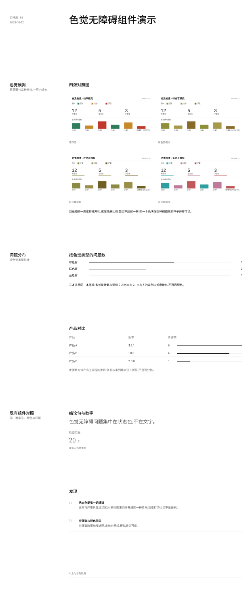

# 组件改动 k6(待审,第 1 版)

组件 Agent 做出的示例,合并前需要人工审批:
- 通过:`node scripts/component-loop.mjs approve k6`
- 写意见让 Agent 再改一版:`node scripts/component-loop.mjs revise k6 "意见"`
- 自己改代码:直接改 `traces/_components/k6/app/`,改完再 approve
- 不采用:`node scripts/component-loop.mjs reject k6 "原因"`

## 示例效果

演示页用组件 Agent 自造的测试数据,新部件和一小段现有组件放在同一页:



切块截图在 `traces/_components/k6/tile-*.png`。

## 组件 Agent 的说明

所有检查通过。下面是这次交付的说明。

## 新部件

**`FigureCompare`**(新增,从 `report/index.tsx` 导出)
- 管什么:色觉模拟那种「原界面 + 三种模拟」的四张一组对照图。2×2 铺满内容列宽,每张图**定高 240px、宽随原比例**,所以不管截图什么比例,整组永远是两行,一屏内读完;每格的图注贴着图宽、不横跨整格。
- 来自哪:`FigureStrip`/`FigureGrid` 的同一套 `Figure*` 部件(没有现成 shadcn 组件可抄,是布局容器,用 `div` + 既有部件组合)。
- 和 `FigureGrid` 的分工:`FigureGrid` 让图铺满列宽、行高随比例,图片很高时一组会超出一屏;`FigureCompare` 把高度定在图上,保证四张一屏。
- 组合:

```tsx
<Group title="四张对照图">
  <FigureCompare>
    {views.map((v) => (
      <Figure key={v.name}>
        <FigureImage src={v.image} alt={v.name} />
        <FigureLabel>{v.name}</FigureLabel>
      </Figure>
    ))}
  </FigureCompare>
</Group>
```

## 改过的已有组件(以及为什么)

1. **`ui/progress.tsx`(改)** —— 来自 shadcn `progress`(Radix `Progress` 原语)。原来是「圆角填充块 + 20% 底色的轨道」被裁成发丝线,和表格行线同重同色。改成:一条 1px 的 `border-border` **基线**(与量程等宽),上面压一条 **2px 的 `border-foreground` 条身**,条长 = 值/最大值。这样长度差就是读数差,不再是一条说不出作用的线。这一处同时修好了 DataTable 的 `bar` 列和 ProgressList。
2. **`report/index.tsx` 的 `Group`(改)** —— 标题从 `text-sm font-semibold`(和正文同字号)改成 `text-xl font-medium`,即比正文 14px 大一级的 20px,让「明细」里的几张表一眼看出是几块;标题与正文间距保持贴紧(8→12px),标题归属自己的内容。之所以用 20px 而不是别的:字号表里 14 和 20 之间没有级别,只有 20px 是正文的上一级。
3. **`report/render.tsx`(改)** —— DataTable 的 `bar` 单元注释更新;ProgressList 非 compact 布局的数值从 `text-muted-foreground` 改为正文色 + `tabular-nums`,和页面其它数字同一套呈现(原来同一组件的两种布局数字颜色不一致)。

## 演示页与测试数据

`Page.tsx` 只放新部件:色觉模拟(`FigureCompare`)、问题分布(`ProgressList` + 带 `bar` 的 `DataTable`)、再加一小段现有组件(`Text`/`Stat`/`List`/`Rule`)对照风格。图片是自造的 4 张 1200×510 SVG(`assets/cvd-*.svg`),同一块界面只有状态色不同。

## 需求里没做的部分及原因

- **刻度(ticks)/阈值线/`max` 等新 props 没加**:规范第 2 条禁止加切换样式或结构的配置 props;而且需求原文是「基线**或**刻度」,基线已经给出量程(0→max)与对齐线,所以只做了基线。k5 里给 Progress 加 `max`/`ticks`/`threshold` 的写法这次没有沿用。
- **`Block` 的标题没动**:需求点名的是 `Group`;`Block` 的「14px 粗体紧贴内容」是已写进 `components.md` 的行为,改了会影响网格里的行高,不在本次范围。
- **没给 `FigureCompare` 加裁剪/`object-fit`**:规范要求不裁剪,所以图只按比例缩放、不定宽裁剪;比例与格宽不同时右侧留白,而不是裁掉内容。

截图:thumb.png 与 tile-1…5.png,`checks.json` 为空(程序检查全部通过)。

## 需求(Maintainer 归纳的「组件不够」问题,4 条)

- **交互流程挖掘 P-15**(审美 judge,f2):DataTable 的 bar 细条颜色过淡、粗细与表格行线相同,使产品对比的步骤数列看不出数量差别,像一条说不出作用的装饰线。
- **色觉无障碍分析 P-12**(审美 judge,c2、c3):色觉模拟要展示原界面与三种色觉模拟的四张对照图，但组件库缺少能把四张图在一屏内以可辨尺寸排成一组对照的组件，所以无法展示。
- **色觉无障碍分析 P-15**(审美 judge,c1、c3、c4):ProgressList 的条是发丝细线或等长虚线、不带基线或刻度，条目标签还带多种颜色，使「按色觉类型的问题数」一栏既看不出数值差异、说不出这条线的作用，也与页面其它数字的呈现方式不一致。
- **色觉无障碍分析 P-21**(审美 judge,c2):Group 的标题与正文同字号、只靠字重区分，使明细一节里几张表的分组标题层级弱，读者一眼看不出这一节分成几块。

## 检查

演示页程序检查:
无问题

组件代码检查(已有代码和 tokens 不改;新增代码只用 token、规范的字号,无阴影和底色;从 shadcn 复制来的文件也查):
无问题

## 改动

```diff
diff --git a/src/components/report/index.tsx b/src/components/report/index.tsx
index ada85e5..0d02ad8 100644
--- a/src/components/report/index.tsx
+++ b/src/components/report/index.tsx
@@ -42,10 +42,14 @@ export function Section({ title, description, className, children }: { title: st
   )
 }
 
+// A group of content, 24px between children. The group's title is a sub-head of
+// the section: it is set one size step above the body text (20px against the
+// body's 14px), so a run of groups reads as separate blocks instead of as one
+// column of same-size lines told apart by weight alone.
 export function Group({ title, className, children }: { title?: string; className?: string; children: React.ReactNode }) {
   return (
-    <div data-slot="group" className="flex flex-col gap-2">
-      {title && <h3 className="text-sm leading-6 font-semibold">{title}</h3>}
+    <div data-slot="group" className="flex flex-col gap-3">
+      {title && <h3 data-slot="group-title" className="text-xl leading-6 font-medium">{title}</h3>}
       <div data-slot="group-body" className={cn("flex flex-col gap-6", className)}>{children}</div>
     </div>
   )
@@ -137,6 +141,31 @@ export function FigureGrid({ className, children, ...props }: React.ComponentPro
   )
 }
 
+// The comparison set for colour vision (the interface plus its simulations) has
+// to be read as one group: all four views together, at a size where what is
+// inside them still reads, and the whole group inside one screen. Two columns
+// give the width (a quarter of the content column would be a thumbnail); the
+// height is pinned on the images instead of being left to the column width, so
+// the group is always two bounded rows whatever the screenshots' proportions
+// are. Each image keeps its own ratio and its own width, and the caption wraps
+// under its image rather than across the cell.
+export function FigureCompare({ className, children, ...props }: React.ComponentProps<"div">) {
+  return (
+    <div
+      data-slot="figure-compare"
+      className={cn(
+        "grid w-full grid-cols-2 gap-x-6 gap-y-6",
+        "[&>[data-slot=figure]]:w-fit [&>[data-slot=figure]]:max-w-full",
+        "[&_[data-slot=figure-image]]:h-60 [&_[data-slot=figure-image]]:w-auto [&_[data-slot=figure-image]]:max-w-full",
+        className
+      )}
+      {...props}
+    >
+      {children}
+    </div>
+  )
+}
+
 // A group marker: one hairline, the same 1px weight as a table's row lines, with
 // an optional label on the line above it. Used where the page groups blocks of
 // content (one product per chain-detail group) and the only other rule in sight
diff --git a/src/components/report/render.tsx b/src/components/report/render.tsx
index a3abb86..2ced425 100644
--- a/src/components/report/render.tsx
+++ b/src/components/report/render.tsx
@@ -341,7 +341,9 @@ export function Node({ node, ctx = {} }: { node: SpecNode; ctx?: Ctx }) {
         ) : c.bar ? (
           <div className="flex items-center gap-3">
             <span className="w-8 tabular-nums">{v}</span>
-            {/* the bar is a hairline on a lighter rule, not a filled block */}
+            {/* the count is drawn as a two-pixel bar on a hairline baseline, so
+                the length against that baseline is the difference the eye reads
+                (a hairline on a hairline made every row look the same) */}
             <Progress value={((Number(v) || 0) / max[c.key]) * 100} className="flex-1" />
           </div>
         ) : (
@@ -525,7 +527,8 @@ export function Node({ node, ctx = {} }: { node: SpecNode; ctx?: Ctx }) {
     case "progress-list":
       // compact: one line per item (label, bar, value). The label column is one grid
       // column (74px) plus the gutter (24px), so the bar starts on the same column
-      // line as the table next to it instead of on a line of its own.
+      // line as the table next to it instead of on a line of its own. The bar is
+      // read against its baseline, and the value is tabular so the counts line up.
       if (p.compact)
         return (
           <div {...mark(node)} data-slot="custom-progress-list" className={outer(node, ctx, "flex flex-col gap-2")}>
@@ -544,7 +547,10 @@ export function Node({ node, ctx = {} }: { node: SpecNode; ctx?: Ctx }) {
             <div key={i} className="flex flex-col gap-2">
               <div className="flex items-center justify-between text-sm">
                 <span>{it.label}</span>
-                <span className="tabular-nums text-muted-foreground">{it.display ?? it.value}</span>
+                {/* the count is the row's data, so it is set like every other
+                    number on the page (same colour, tabular figures) instead of
+                    dropping to the note grey */}
+                <span className="tabular-nums">{it.display ?? it.value}</span>
               </div>
               <Progress value={(it.value / (it.max ?? 100)) * 100} />
             </div>
diff --git a/src/components/ui/progress.tsx b/src/components/ui/progress.tsx
index 7cd139a..7d1de8e 100644
--- a/src/components/ui/progress.tsx
+++ b/src/components/ui/progress.tsx
@@ -4,11 +4,12 @@ import * as React from "react"
 import { cn } from "@/lib/utils"
 import { Progress as ProgressPrimitive } from "radix-ui"
 
-// A bar that carries a count, not an alarm: it is drawn as a hairline on a
-// slightly lighter rule, the same weight as the table's row lines, so it never
-// outweighs the text it annotates. The rule and the bar are both drawn as
-// borders, never as a filled background: the design has no panels or fills,
-// only lines.
+// A bar that carries a count, read against a baseline: the value is the length
+// of the ink laid along that line, so two counts are told apart by how far the
+// bar reaches, not by a tint. The baseline is a hairline the width of the scale
+// (zero to max); the bar is two pixels of foreground ink sitting on it, heavier
+// than the table's row lines so it cannot be mistaken for one, and dark enough
+// to read against the baseline at a glance.
 function Progress({
   className,
   value,
@@ -17,16 +18,16 @@ function Progress({
   return (
     <ProgressPrimitive.Root
       data-slot="progress"
-      className={cn("relative h-px w-full overflow-hidden", className)}
+      className={cn("relative h-2 w-full", className)}
       {...props}
     >
       <div
-        data-slot="progress-track"
-        className="absolute inset-0 border-t border-border"
+        data-slot="progress-baseline"
+        className="absolute inset-x-0 bottom-0 border-b border-border"
       />
       <ProgressPrimitive.Indicator
         data-slot="progress-indicator"
-        className="absolute inset-y-0 left-0 border-t border-muted-foreground transition-all"
+        className="absolute bottom-0 left-0 border-b-2 border-foreground transition-all"
         style={{ width: `${value || 0}%` }}
       />
     </ProgressPrimitive.Root>
diff --git a/components.md b/traces/_components/k6/components.md
index cdb7e94..e43cce3 100644
--- a/components.md
+++ b/traces/_components/k6/components.md
@@ -4,7 +4,7 @@
 
 ```tsx
 import data from "./data.json"
-import { Page, Section, Group, Grid, Block, Text, Stat, DataTable, TrendChart, BarChart, ProgressList, List, KV, Rule, FigureStrip, FigureGrid, Figure, FigureImage, FigureLabel, FigureText } from "@/components/report"
+import { Page, Section, Group, Grid, Block, Text, Stat, DataTable, TrendChart, BarChart, ProgressList, List, KV, Rule, FigureStrip, FigureGrid, FigureCompare, Figure, FigureImage, FigureLabel, FigureText } from "@/components/report"
 ```
 
 不直接写 HTML 标签(`<div>` 除外,也尽量不用),不写 `style`,不写颜色类名和任意值类名(如 `text-[13px]`)。字号、颜色、间距都由组件给出;规范允许的类名只有 design.md 里写明的几个。
@@ -17,7 +17,7 @@ import { Page, Section, Group, Grid, Block, Text, Stat, DataTable, TrendChart, B
 |---|---|---|
 | `Page` | `title`, `meta?: string[]`, `className?` | 页头:`meta` 在左侧 3 列(产品、周期),`title` 在右侧 9 列。节之间默认 192px |
 | `Section` | `title`, `description?`, `className?` | 节标题和说明挂在左侧 3 列,子元素在右侧 9 列,子元素之间默认 192px |
-| `Group` | `title?`, `className?` | 一组内容,子元素之间 24px |
+| `Group` | `title?`, `className?` | 一组内容,子元素之间 24px。`title` 是节内的子块标题,比正文大一级(20px 对正文 14px),让一组内容一眼看出是独立的一块,不再和正文同字号、只靠字重区分 |
 | `Grid` | `cols?`(默认 9), `fields?`(默认 true), `span?`, `className?` | 网格。`fields` 为 true 时每行高 144px,子元素用 `rows` 占整行;为 false 时行高随内容 |
 | `Block` | `span?`, `rows?`, `title?`, `description?`, `contentClassName?` | 网格里的一块,标题 14px 粗体紧贴内容 |
 
@@ -29,10 +29,10 @@ import { Page, Section, Group, Grid, Block, Text, Stat, DataTable, TrendChart, B
 |---|---|---|
 | `Text` | children(字符串) | 一段文字,默认 14px |
 | `Stat` | `value`, `label?`, `unit?`, `size?: "lg" \| "xl"`, `captionBelow?`, `quiet?`, `note?`, `delta?`, `direction?: "up" \| "down"` | 一个数字。默认 30px,`lg` 48px 细体。`captionBelow` 把 `label` 放在数字下面。`note` 是一行 12px 注释;`direction: "down"` 且没有 `delta` 时注释为红色 |
-| `DataTable` | `columns`, `rows`, `caption?` | 表格。`columns` 每项:`key`, `label`, `align?: "right"`, `span?`(占几列网格,写了就按网格定列宽;一行的 `span` 加起来 9 正好铺满内容列), `bar?`(数字后接细条), `tone?: string[]`(这些值标红**并加粗**(正文 400 → 600)——红色在灰度打印里比黑字还浅,色弱读者也看不出红,所以状态必须有一个颜色之外的通道,字重就是它), `muteWhen?: {key, equals}`(行灰显), `interval?: {low, high, domain: [min, max]}`(画区间图)。`caption` 是表格**下方**一行灰色小字注释(如口径、阈值说明),左对齐,与表格左边缘齐平;不是表名,表名用外面 `Group` 的 `title` |
+| `DataTable` | `columns`, `rows`, `caption?` | 表格。`columns` 每项:`key`, `label`, `align?: "right"`, `span?`(占几列网格,写了就按网格定列宽;一行的 `span` 加起来 9 正好铺满内容列), `bar?`(数字后接计数条:2px 墨线画在一条 1px 基线上,条长是该值与同列最大值的比,和表格行线不同重、不同色,所以看得出数量差别), `tone?: string[]`(这些值标红**并加粗**(正文 400 → 600)——红色在灰度打印里比黑字还浅,色弱读者也看不出红,所以状态必须有一个颜色之外的通道,字重就是它), `muteWhen?: {key, equals}`(行灰显), `interval?: {low, high, domain: [min, max]}`(画区间图)。`caption` 是表格**下方**一行灰色小字注释(如口径、阈值说明),左对齐,与表格左边缘齐平;不是表名,表名用外面 `Group` 的 `title` |
 | `TrendChart` | `data`, `xKey`, `series: {key, label}[]`, `height?`, `band?: {low, high}`, `zero?`, `yTicks?`, `xInterval?`, `pointLabels?: "last"`, `lastLabel?` | 折线图。`height` 用 `"h-48"` 之类,或 `"fill"` 填满所在块 |
 | `BarChart` | `data`, `xKey`, `series`, `layout?: "horizontal"` | 柱状图;`horizontal` 是横向细条 |
-| `ProgressList` | `items: {label, value, max?, display?}[]`, `compact?` | 进度条列表;`compact` 每行依次是名称、细条、数值。条是 1px 细线,与表格行线同重,颜色比轨道深一档,只承载计数,不抢正文 |
+| `ProgressList` | `items: {label, value, max?, display?}[]`, `compact?` | 进度条列表;`compact` 每行依次是名称、条、数值。条是 2px 墨线画在一条 1px 基线上,基线与量程(0 到 `max`)等宽,条长是计数与满值之比,所以同一列表里的数值差异由长度给出,而不是靠颜色;数值用和页面其它数字一致的等宽数字 |
 | `List` | `items: {title?, description?, meta?}[]`, `numbered?`, `ordered?`, `columns?`, `divided?`, `metaTone?: "destructive"` | 列表。`numbered` 带 01、02 序号和行间细线;`columns` 并排;`ordered` 带 1、2 序号 |
 | `KV` | `items: {label, value}[]`, `labelCols?` | 键值表;`labelCols` 让标签占几列网格 |
 | `Rule` | `label?` | 分组标记:一条 1px 细线(与表格行线同宽),上面可带一行 12px 标签。用在两组内容之间做分组,如链路明细里一个产品一组;两组内容之间的分组标记用 `Rule`,不要用粗条 |
@@ -44,9 +44,10 @@ import { Page, Section, Group, Grid, Block, Text, Stat, DataTable, TrendChart, B
 | 组件 | props | 说明 |
 |---|---|---|
 | `FigureStrip` | children | 一行截图,放在 shadcn `ScrollArea` 里横向滚动,滚动条是 shadcn 的样式(不是浏览器原生滚动条),只在鼠标悬停时出现,静止时不占地方也不画横条;超出宽度的部分裁掉,不把页面撑宽。行高由这条自己定:所有图同高、宽度各按原比例,所以手机 375×760 和分析图 1200×760 能并排对齐 |
-| `FigureGrid` | children | 一版对照图,两列铺满内容列宽,每格一张 `Figure`;图按列宽显示、高度随原比例,用于一屏内要看清图内文字的对照(原界面 + 色觉模拟) |
+| `FigureGrid` | children | 一版对照图,两列铺满内容列宽,每格一张 `Figure`;图按列宽显示、高度随原比例,用于要看清图内细节的对照,行高不限 |
+| `FigureCompare` | children | 一组四张的对照图(原界面 + 三种色觉模拟),2×2 铺满内容列宽,每张图定高、宽随原比例,整组固定为两行,一屏内读完;每格的图注贴着图,不横跨整格 |
 | `Figure` | children | 一张截图的外框,纵向排图、标签和说明;宽度随所在布局,不收缩 |
-| `FigureImage` | `src`, `alt` | 截图本体。宽度随所在布局、高度随原比例,**自己不定高**:在 `FigureStrip` 里由条给统一高度(比例不同的图才对得齐),在 `FigureGrid` 里铺满所在列宽(图内文字才看得清)。不裁剪 |
+| `FigureImage` | `src`, `alt` | 截图本体。宽度随所在布局、高度随原比例,自己不定高(定高的是容器):在 `FigureStrip` 里由条给统一高度(比例不同的图才对得齐),在 `FigureGrid` 里铺满所在列宽(图内文字才看得清),在 `FigureCompare` 里由格给统一高度、宽随比例。不裁剪 |
 | `FigureLabel` | children(字符串) | 图下面或上面的视图名(屏名、步号),12px 灰色 |
 | `FigureText` | children(字符串) | 图下面的说明(内容、操作、输入项),14px 正文 |
 
@@ -71,15 +72,19 @@ import { Page, Section, Group, Grid, Block, Text, Stat, DataTable, TrendChart, B
 
 模拟视图:一组四张(原界面 + 三种色觉模拟),每张带视图名,两列铺满内容列宽;要放说明文字就用 `Block` 的 `title`/`description` 包住这一组。`FigureLabel` 放在 `FigureImage` 前就是名称在上,放在后就是名称在下。
 
+用 `FigureGrid` 时每张图按列宽显示,行高随图片比例,图片很高时一组会超出一屏;四张要在一屏内读完就用 `FigureCompare`:它把高度定在图上,所以不管截图什么比例,整组都是两行。
+
 ```tsx
 <Group title="色觉模拟">
-  <FigureGrid>
+  <FigureCompare>
     {views.map((view) => (
       <Figure key={view.name}>
         <FigureImage src={view.image} alt={view.name} />
         <FigureLabel>{view.name}</FigureLabel>
       </Figure>
     ))}
-  </FigureGrid>
+  </FigureCompare>
 </Group>
 ```
+
+要在图下再写一行说明,就在 `FigureCompare` 的每张 `Figure` 里 `FigureImage` 后加 `FigureText`(和 `FigureGrid` 一样)。

```
