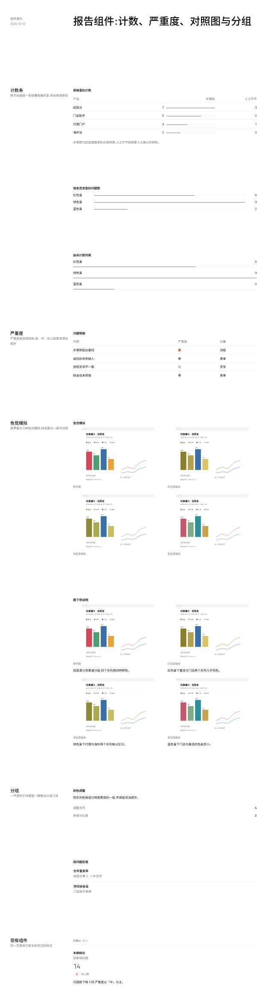

# 组件改动 k7(待审,第 1 版)

组件 Agent 做出的示例,合并前需要人工审批:
- 通过:`node scripts/component-loop.mjs approve k7`
- 写意见让 Agent 再改一版:`node scripts/component-loop.mjs revise k7 "意见"`
- 自己改代码:直接改 `traces/_components/k7/app/`,改完再 approve
- 不采用:`node scripts/component-loop.mjs reject k7 "原因"`

## 示例效果

演示页用组件 Agent 自造的测试数据,新部件和一小段现有组件放在同一页:



切块截图在 `traces/_components/k7/tile-*.png`。

## 组件 Agent 的说明

一切就绪,程序检查全过(`checks.json` 为空),页面 8 块截图逐块看过。下面是这次的改动与说明。

## 结论:没有新增部件名,需求里 6 条都是已有部件缺的能力

需求全部落在 `DataTable` / `ProgressList` / `FigureCompare` / `Group` 这 4 个部件上,所以我没有另起部件名,而是把这 4 个部件缺的能力补进去(顺带改了它们共用的那条计数条)。改的文件:`app/src/components/ui/progress.tsx`、`app/src/components/report/render.tsx`、`app/src/components/report/index.tsx`、`components.md`,加演示页 `Page.tsx`、测试图 `assets/*.svg`(生成脚本 `make-assets.mjs`)。

## 各部件改了什么、管什么、来自哪里

**1. 计数条(`ui/progress.tsx`,来自 shadcn `progress` + Radix `Progress`)——对应「DataTable 的 bar」和「ProgressList 的条」**

一条 1px 墨线画在一条 1px 基线上:基线与量程(0 到 max)等宽、和表格行线同宽同色(浅灰),条用墨色,长度就是计数与满值之比。两处共用这一条条、同一套等宽数字,不再各画一种形式。

- 对 R1:条用墨色、行线用浅灰,条的末端一眼可辨,不会被读成一条说不出作用的装饰线;条长按同列最大值归一,数量差别由长度给出。
- 对 R3:原来条是 2px 墨线,是全页唯一比细线粗的线;现在和页面其它细线同宽(1px),视觉重量落回细线这一级。
- 组合:`<DataTable columns={[{ key:"steps", label:"步骤数", align:"right", span:3, bar:true }]} rows={rows} />`,或 `<ProgressList items={byType} compact />`。

**2. `DataTable` 列的 `levels`(来自 shadcn `table`)——对应「严重度只有「高」有颜色」**

`columns` 新增 `levels?: string[]`(从低到高排)。最高一级标红并加粗,次一级加粗,再往下用注释灰;三级都和正文有区别,读者能把严重度排出顺序。`tone` 保留给「是/不是」一个状态,等级用 `levels`。

- 组合:`{ key:"severity", label:"严重度", span:2, levels:["低","中","高"] }`。

**3. `ProgressList` 的量程(`render.tsx`)——对应「看不出数值差异、说不出这条线的作用」**

`max` 不给时取列表里的最大值(原来固定按 0..100 算,6/9/2 这种小计数全缩成等长的发丝线,像等长虚线);现在 6、9、2 画成 67%、100%、22%,差异一眼可辨。数值用与页面其它数字一致的等宽数字。

- 组合:`<ProgressList items={[{ label:"红色盲", value:6 }, { label:"绿色盲", value:9 }]} compact />`。

**4. `FigureCompare`(纯 `div` + `img`)——对应「四张对照图被拉成上下两屏」**

每格图按原比例、高度封在同一个上限(`max-h-64`),图注占满整格宽。整组固定两行(实测约 600px,一屏内),截图比例偏长也不会撑到第二屏;图注也不再折成多行把格撑高。

- 组合:`<FigureCompare>{views.map(v => <Figure key={v.name}><FigureImage src={v.image} alt={v.name} /><FigureLabel>{v.name}</FigureLabel></Figure>)}</FigureCompare>`。

**5. `Group` 的子块标题(纯 `div`/`h3`)——对应「子块标题与节标题同为 20px」**

子块标题从 20px 降到 14px 粗体(节标题仍是 20px),标题与内容之间收到 8px;一节里「颜色调整」「按问题处理」这类子块一眼看出是分开的几块,不再和节标题同字号。

## 需求里没做/没照字面做的部分

- **R1 的「粗细与表格行线相同」没照字面改**:条仍是 1px(与行线同宽),靠颜色区分(墨色对浅灰)。因为 R3/R5 明确要求条「与页面细线一致的细条」「不与正文争夺视觉重量」,两条要求方向相反;取的是中间——同宽不同色,再加一条与量程等宽的基线让长度有基准。
- **R5 的「条目标签带多种颜色」没有对应改动**:`ProgressList` 的标签本来就是正文色,那条记录来自页面自己给标签上色,组件里没有可改的地方。
- **R5 的「刻度」只做到基线**:基线与量程等宽,长度本身就是基准;没再加刻度线/刻度值,否则会和紧凑模式右侧的数值列重复。

## 需求(Maintainer 归纳的「组件不够」问题,6 条)

- **交互流程挖掘 P-15**(审美 judge,f2):DataTable 的 bar 细条颜色过淡、粗细与表格行线相同,使产品对比的步骤数列看不出数量差别,像一条说不出作用的装饰线。
- **交互流程挖掘 P-21**(审美 judge,f2):DataTable 的 tone 只提供一种红色标记，使问题明细表的严重度列只有「高」有颜色，中、低两级与正文没有视觉区别，读者读不出严重度的连续层级。
- **色觉无障碍分析 P-06**(审美 judge,c1、c3、c4):ProgressList 的条比页面其它细线粗，使「按色盲类型」一栏的计数条成为屏内视觉重量最大的一块，与全页细线风格不一致。
- **色觉无障碍分析 P-12**(审美 judge,c2、c3):FigureCompare 的每格图高固定、图注又各占一行，使截图比例偏长的报告里四张对照图仍被拉成上下两屏，后一屏只剩两张图与两个图注，读者无法在一屏内完成对照。
- **色觉无障碍分析 P-15**(审美 judge,c1、c3、c4):ProgressList 的条是发丝细线或等长虚线、不带基线或刻度，条目标签还带多种颜色，使「按色觉类型的问题数」一栏既看不出数值差异、说不出这条线的作用，也与页面其它数字的呈现方式不一致。
- **色觉无障碍分析 P-21**(审美 judge,c1、c2):Group 的子块标题与节标题同为 20px，使「下一步」等节里的「颜色调整」「按问题处理」这类子块标题与节标题分不出层级，读者看不出这一节分成几块。

## 检查

演示页程序检查:
无问题

组件代码检查(已有代码和 tokens 不改;新增代码只用 token、规范的字号,无阴影和底色;从 shadcn 复制来的文件也查):
无问题

## 改动

```diff
diff --git a/src/components/report/index.tsx b/src/components/report/index.tsx
index 0d02ad8..b4be742 100644
--- a/src/components/report/index.tsx
+++ b/src/components/report/index.tsx
@@ -42,14 +42,15 @@ export function Section({ title, description, className, children }: { title: st
   )
 }
 
-// A group of content, 24px between children. The group's title is a sub-head of
-// the section: it is set one size step above the body text (20px against the
-// body's 14px), so a run of groups reads as separate blocks instead of as one
-// column of same-size lines told apart by weight alone.
+// A group of content, 8px from the title to its content and 24px between the
+// content pieces. The group's title is a sub-head: it is set at body size and
+// bold, one size step below the section title (14px against the section's
+// 20px), so a run of groups reads as separate blocks under their section
+// instead of repeating the section heading at its own size.
 export function Group({ title, className, children }: { title?: string; className?: string; children: React.ReactNode }) {
   return (
-    <div data-slot="group" className="flex flex-col gap-3">
-      {title && <h3 data-slot="group-title" className="text-xl leading-6 font-medium">{title}</h3>}
+    <div data-slot="group" className="flex flex-col gap-2">
+      {title && <h3 data-slot="group-title" className="text-sm leading-6 font-semibold">{title}</h3>}
       <div data-slot="group-body" className={cn("flex flex-col gap-6", className)}>{children}</div>
     </div>
   )
@@ -145,18 +146,18 @@ export function FigureGrid({ className, children, ...props }: React.ComponentPro
 // to be read as one group: all four views together, at a size where what is
 // inside them still reads, and the whole group inside one screen. Two columns
 // give the width (a quarter of the content column would be a thumbnail); the
-// height is pinned on the images instead of being left to the column width, so
-// the group is always two bounded rows whatever the screenshots' proportions
-// are. Each image keeps its own ratio and its own width, and the caption wraps
-// under its image rather than across the cell.
+// images keep their own ratio and are capped at one height, so the group is
+// always two bounded rows whatever the screenshots' proportions are, and a tall
+// screenshot is not stretched into a second screen. The caption runs the width
+// of its cell, so a narrow view does not wrap its label into a column of lines.
 export function FigureCompare({ className, children, ...props }: React.ComponentProps<"div">) {
   return (
     <div
       data-slot="figure-compare"
       className={cn(
         "grid w-full grid-cols-2 gap-x-6 gap-y-6",
-        "[&>[data-slot=figure]]:w-fit [&>[data-slot=figure]]:max-w-full",
-        "[&_[data-slot=figure-image]]:h-60 [&_[data-slot=figure-image]]:w-auto [&_[data-slot=figure-image]]:max-w-full",
+        "[&>[data-slot=figure]]:w-full [&>[data-slot=figure]]:min-w-0",
+        "[&_[data-slot=figure-image]]:max-h-64 [&_[data-slot=figure-image]]:w-auto [&_[data-slot=figure-image]]:max-w-full",
         className
       )}
       {...props}
diff --git a/src/components/report/render.tsx b/src/components/report/render.tsx
index 2ced425..acbfcdb 100644
--- a/src/components/report/render.tsx
+++ b/src/components/report/render.tsx
@@ -314,13 +314,24 @@ export function Node({ node, ctx = {} }: { node: SpecNode; ctx?: Ctx }) {
       // interval: the cell draws the row's estimate (key) with its range (low..high) on an axis shared by the column.
       // muteWhen: the cell is greyed when the row's field equals the value (e.g. not significant).
       type Col = {
-        key: string; label: string; align?: "left" | "right"; bar?: boolean; span?: number; tone?: string[]
+        key: string; label: string; align?: "left" | "right"; bar?: boolean; span?: number; tone?: string[]; levels?: string[]
         interval?: { low: string; high: string; domain: [number, number] }
         muteWhen?: { key: string; equals: unknown }
       }
       const cols = p.columns as Col[]
       const onGrid = cols.some((c) => c.span)
       const rows = p.rows as Record<string, React.ReactNode>[]
+      // levels: a column whose values are one ordered scale (low to high). The
+      // top of the scale carries the destructive colour; the step below it is
+      // bold; the steps under that fall back to the note grey. Colour alone
+      // would only mark one state, so the weight and the grey carry the rest of
+      // the order and the reader can rank the values.
+      const step = (c: Col, v: React.ReactNode) => {
+        const i = c.levels ? c.levels.indexOf(String(v)) : -1
+        if (i < 0) return undefined
+        const fromTop = c.levels!.length - 1 - i
+        return fromTop === 0 ? "font-semibold text-destructive" : fromTop === 1 ? "font-semibold" : "text-muted-foreground"
+      }
       // A numeric column can carry an inline bar, scaled to the column's max.
       const max = Object.fromEntries(cols.filter((c) => c.bar).map((c) => [c.key, Math.max(...rows.map((r) => Number(r[c.key]) || 0))]))
       const interval = (c: Col, r: Record<string, React.ReactNode>, muted: boolean) => {
@@ -384,6 +395,7 @@ export function Node({ node, ctx = {} }: { node: SpecNode; ctx?: Ctx }) {
                         // the state carries weight as well as colour: bolder than the body
                         // text, so it survives greyscale and colour blindness
                         c.tone?.includes(String(r[c.key])) && "font-semibold text-destructive",
+                        step(c, r[c.key]),
                         c.muteWhen && r[c.muteWhen.key] === c.muteWhen.equals && "text-muted-foreground/70",
                       )}
                     >
@@ -524,7 +536,15 @@ export function Node({ node, ctx = {} }: { node: SpecNode; ctx?: Ctx }) {
       )
     }
 
-    case "progress-list":
+    case "progress-list": {
+      // Every bar in the list is read against one scale, so the lengths are
+      // comparable inside the list: the scale runs from zero to the largest
+      // count in the list unless an item names its own max. (Falling back to a
+      // fixed 0..100 left every count a sliver of the same length, which reads
+      // as a dashed rule rather than as a value.)
+      const items = p.items as { label: string; value: number; max?: number; display?: string }[]
+      const scale = Math.max(1, ...items.map((it) => Number(it.value) || 0))
+      const bar = (it: { value: number; max?: number }) => ((Number(it.value) || 0) / (it.max ?? scale)) * 100
       // compact: one line per item (label, bar, value). The label column is one grid
       // column (74px) plus the gutter (24px), so the bar starts on the same column
       // line as the table next to it instead of on a line of its own. The bar is
@@ -532,10 +552,10 @@ export function Node({ node, ctx = {} }: { node: SpecNode; ctx?: Ctx }) {
       if (p.compact)
         return (
           <div {...mark(node)} data-slot="custom-progress-list" className={outer(node, ctx, "flex flex-col gap-2")}>
-            {(p.items as { label: string; value: number; max?: number; display?: string }[]).map((it, i) => (
+            {items.map((it, i) => (
               <div key={i} className="grid h-6 grid-cols-[74px_1fr_2rem] items-center gap-6 text-sm">
                 <span>{it.label}</span>
-                <Progress value={(it.value / (it.max ?? 100)) * 100} />
+                <Progress value={bar(it)} />
                 <span className="text-right tabular-nums">{it.display ?? it.value}</span>
               </div>
             ))}
@@ -543,7 +563,7 @@ export function Node({ node, ctx = {} }: { node: SpecNode; ctx?: Ctx }) {
         )
       return (
         <div {...mark(node)} data-slot="custom-progress-list" className={outer(node, ctx, "flex flex-col gap-4")}>
-          {(p.items as { label: string; value: number; max?: number; display?: string }[]).map((it, i) => (
+          {items.map((it, i) => (
             <div key={i} className="flex flex-col gap-2">
               <div className="flex items-center justify-between text-sm">
                 <span>{it.label}</span>
@@ -552,11 +572,12 @@ export function Node({ node, ctx = {} }: { node: SpecNode; ctx?: Ctx }) {
                     dropping to the note grey */}
                 <span className="tabular-nums">{it.display ?? it.value}</span>
               </div>
-              <Progress value={(it.value / (it.max ?? 100)) * 100} />
+              <Progress value={bar(it)} />
             </div>
           ))}
         </div>
       )
+    }
 
     case "badges":
       return (
diff --git a/src/components/ui/progress.tsx b/src/components/ui/progress.tsx
index 7d1de8e..3db8f57 100644
--- a/src/components/ui/progress.tsx
+++ b/src/components/ui/progress.tsx
@@ -7,9 +7,9 @@ import { Progress as ProgressPrimitive } from "radix-ui"
 // A bar that carries a count, read against a baseline: the value is the length
 // of the ink laid along that line, so two counts are told apart by how far the
 // bar reaches, not by a tint. The baseline is a hairline the width of the scale
-// (zero to max); the bar is two pixels of foreground ink sitting on it, heavier
-// than the table's row lines so it cannot be mistaken for one, and dark enough
-// to read against the baseline at a glance.
+// (zero to max), the same weight and grey as the table's row lines; the bar is
+// one pixel of foreground ink sitting on it, so the bar reads as the inked part
+// of the line and the line stays as light as every other hairline on the page.
 function Progress({
   className,
   value,
@@ -27,7 +27,7 @@ function Progress({
       />
       <ProgressPrimitive.Indicator
         data-slot="progress-indicator"
-        className="absolute bottom-0 left-0 border-b-2 border-foreground transition-all"
+        className="absolute bottom-0 left-0 border-b border-foreground transition-all"
         style={{ width: `${value || 0}%` }}
       />
     </ProgressPrimitive.Root>
diff --git a/components.md b/traces/_components/k7/components.md
index e43cce3..4b14d58 100644
--- a/components.md
+++ b/traces/_components/k7/components.md
@@ -17,7 +17,7 @@ import { Page, Section, Group, Grid, Block, Text, Stat, DataTable, TrendChart, B
 |---|---|---|
 | `Page` | `title`, `meta?: string[]`, `className?` | 页头:`meta` 在左侧 3 列(产品、周期),`title` 在右侧 9 列。节之间默认 192px |
 | `Section` | `title`, `description?`, `className?` | 节标题和说明挂在左侧 3 列,子元素在右侧 9 列,子元素之间默认 192px |
-| `Group` | `title?`, `className?` | 一组内容,子元素之间 24px。`title` 是节内的子块标题,比正文大一级(20px 对正文 14px),让一组内容一眼看出是独立的一块,不再和正文同字号、只靠字重区分 |
+| `Group` | `title?`, `className?` | 一组内容,子元素之间 24px。`title` 是节内的子块标题:标题与内容之间 8px,字号比节标题小一级(14px 粗体对节标题 20px),所以「下一步」这类节里分成几块一眼看得出,子块标题不会和节标题同字号、分不出层级 |
 | `Grid` | `cols?`(默认 9), `fields?`(默认 true), `span?`, `className?` | 网格。`fields` 为 true 时每行高 144px,子元素用 `rows` 占整行;为 false 时行高随内容 |
 | `Block` | `span?`, `rows?`, `title?`, `description?`, `contentClassName?` | 网格里的一块,标题 14px 粗体紧贴内容 |
 
@@ -29,10 +29,10 @@ import { Page, Section, Group, Grid, Block, Text, Stat, DataTable, TrendChart, B
 |---|---|---|
 | `Text` | children(字符串) | 一段文字,默认 14px |
 | `Stat` | `value`, `label?`, `unit?`, `size?: "lg" \| "xl"`, `captionBelow?`, `quiet?`, `note?`, `delta?`, `direction?: "up" \| "down"` | 一个数字。默认 30px,`lg` 48px 细体。`captionBelow` 把 `label` 放在数字下面。`note` 是一行 12px 注释;`direction: "down"` 且没有 `delta` 时注释为红色 |
-| `DataTable` | `columns`, `rows`, `caption?` | 表格。`columns` 每项:`key`, `label`, `align?: "right"`, `span?`(占几列网格,写了就按网格定列宽;一行的 `span` 加起来 9 正好铺满内容列), `bar?`(数字后接计数条:2px 墨线画在一条 1px 基线上,条长是该值与同列最大值的比,和表格行线不同重、不同色,所以看得出数量差别), `tone?: string[]`(这些值标红**并加粗**(正文 400 → 600)——红色在灰度打印里比黑字还浅,色弱读者也看不出红,所以状态必须有一个颜色之外的通道,字重就是它), `muteWhen?: {key, equals}`(行灰显), `interval?: {low, high, domain: [min, max]}`(画区间图)。`caption` 是表格**下方**一行灰色小字注释(如口径、阈值说明),左对齐,与表格左边缘齐平;不是表名,表名用外面 `Group` 的 `title` |
+| `DataTable` | `columns`, `rows`, `caption?` | 表格。`columns` 每项:`key`, `label`, `align?: "right"`, `span?`(占几列网格,写了就按网格定列宽;一行的 `span` 加起来 9 正好铺满内容列), `bar?`(数字后接计数条:1px 墨线画在一条 1px 基线上,基线与量程等宽、与表格行线同宽同色,条长是该值与同列最大值的比。条用墨色、行线用浅灰,所以条的末端一眼可辨,不会被误读成一条说不出作用的行线), `tone?: string[]`(这些值标红**并加粗**(正文 400 → 600)——红色在灰度打印里比黑字还浅,色弱读者也看不出红,所以状态必须有一个颜色之外的通道,字重就是它), `levels?: string[]`(一列有序的等级,从低到高排。最高一级标红并加粗,次一级加粗,再往下用注释灰:三级都与正文有区别,读者能把严重度排出顺序,而不是只有「高」有颜色、中低两级和正文没有视觉区别), `muteWhen?: {key, equals}`(行灰显), `interval?: {low, high, domain: [min, max]}`(画区间图)。`caption` 是表格**下方**一行灰色小字注释(如口径、阈值说明),左对齐,与表格左边缘齐平;不是表名,表名用外面 `Group` 的 `title` |
 | `TrendChart` | `data`, `xKey`, `series: {key, label}[]`, `height?`, `band?: {low, high}`, `zero?`, `yTicks?`, `xInterval?`, `pointLabels?: "last"`, `lastLabel?` | 折线图。`height` 用 `"h-48"` 之类,或 `"fill"` 填满所在块 |
 | `BarChart` | `data`, `xKey`, `series`, `layout?: "horizontal"` | 柱状图;`horizontal` 是横向细条 |
-| `ProgressList` | `items: {label, value, max?, display?}[]`, `compact?` | 进度条列表;`compact` 每行依次是名称、条、数值。条是 2px 墨线画在一条 1px 基线上,基线与量程(0 到 `max`)等宽,条长是计数与满值之比,所以同一列表里的数值差异由长度给出,而不是靠颜色;数值用和页面其它数字一致的等宽数字 |
+| `ProgressList` | `items: {label, value, max?, display?}[]`, `compact?` | 进度条列表;`compact` 每行依次是名称、条、数值。条是 1px 墨线画在一条 1px 基线上:基线与量程(0 到 `max`)等宽、与页面其它细线同宽同色,条长是计数与满值之比,所以同一列表里的数值差异由长度给出,而不是靠颜色,也不会比页面其它细线粗。`max` 不给时取列表里的最大值,所以小计数(6、9、2)也铺满各自的比例,不会都缩成等长的发丝细线;数值用和页面其它数字一致的等宽数字 |
 | `List` | `items: {title?, description?, meta?}[]`, `numbered?`, `ordered?`, `columns?`, `divided?`, `metaTone?: "destructive"` | 列表。`numbered` 带 01、02 序号和行间细线;`columns` 并排;`ordered` 带 1、2 序号 |
 | `KV` | `items: {label, value}[]`, `labelCols?` | 键值表;`labelCols` 让标签占几列网格 |
 | `Rule` | `label?` | 分组标记:一条 1px 细线(与表格行线同宽),上面可带一行 12px 标签。用在两组内容之间做分组,如链路明细里一个产品一组;两组内容之间的分组标记用 `Rule`,不要用粗条 |
@@ -45,7 +45,7 @@ import { Page, Section, Group, Grid, Block, Text, Stat, DataTable, TrendChart, B
 |---|---|---|
 | `FigureStrip` | children | 一行截图,放在 shadcn `ScrollArea` 里横向滚动,滚动条是 shadcn 的样式(不是浏览器原生滚动条),只在鼠标悬停时出现,静止时不占地方也不画横条;超出宽度的部分裁掉,不把页面撑宽。行高由这条自己定:所有图同高、宽度各按原比例,所以手机 375×760 和分析图 1200×760 能并排对齐 |
 | `FigureGrid` | children | 一版对照图,两列铺满内容列宽,每格一张 `Figure`;图按列宽显示、高度随原比例,用于要看清图内细节的对照,行高不限 |
-| `FigureCompare` | children | 一组四张的对照图(原界面 + 三种色觉模拟),2×2 铺满内容列宽,每张图定高、宽随原比例,整组固定为两行,一屏内读完;每格的图注贴着图,不横跨整格 |
+| `FigureCompare` | children | 一组四张的对照图(原界面 + 三种色觉模拟),2×2 铺满内容列宽,每张图按原比例缩放到同一个高度上限(`max-h-64`),所以不管截图比例多长,整组都是两行、一屏内读完,不会因为图高按列宽走而被拉成上下两屏;每格的图注占满整格宽,窄图的长图注不会折成多行把整组撑高 |
 | `Figure` | children | 一张截图的外框,纵向排图、标签和说明;宽度随所在布局,不收缩 |
 | `FigureImage` | `src`, `alt` | 截图本体。宽度随所在布局、高度随原比例,自己不定高(定高的是容器):在 `FigureStrip` 里由条给统一高度(比例不同的图才对得齐),在 `FigureGrid` 里铺满所在列宽(图内文字才看得清),在 `FigureCompare` 里由格给统一高度、宽随比例。不裁剪 |
 | `FigureLabel` | children(字符串) | 图下面或上面的视图名(屏名、步号),12px 灰色 |
@@ -72,7 +72,7 @@ import { Page, Section, Group, Grid, Block, Text, Stat, DataTable, TrendChart, B
 
 模拟视图:一组四张(原界面 + 三种色觉模拟),每张带视图名,两列铺满内容列宽;要放说明文字就用 `Block` 的 `title`/`description` 包住这一组。`FigureLabel` 放在 `FigureImage` 前就是名称在上,放在后就是名称在下。
 
-用 `FigureGrid` 时每张图按列宽显示,行高随图片比例,图片很高时一组会超出一屏;四张要在一屏内读完就用 `FigureCompare`:它把高度定在图上,所以不管截图什么比例,整组都是两行。
+用 `FigureGrid` 时每张图按列宽显示,行高随图片比例,图片很高时一组会超出一屏;四张要在一屏内读完就用 `FigureCompare`:它把每张图的高度封在同一个上限上,所以不管截图比例多长,整组都是两行。
 
 ```tsx
 <Group title="色觉模拟">
@@ -88,3 +88,21 @@ import { Page, Section, Group, Grid, Block, Text, Stat, DataTable, TrendChart, B
 ```
 
 要在图下再写一行说明,就在 `FigureCompare` 的每张 `Figure` 里 `FigureImage` 后加 `FigureText`(和 `FigureGrid` 一样)。
+
+## 计数与严重度
+
+一个计数用一条按量程画的条表示:基线与量程(0 到 `max`)等宽、和表格行线同一条浅灰细线,条是画在它上面的 1px 墨线,长度就是计数与满值之比。计数条只出现在两处——`DataTable` 的 `bar` 列和 `ProgressList`——两处同一条条、同一套数字,不另起一种形式。
+
+严重度这类有序等级用列的 `levels`:从低到高排开,最高一级红加粗,次一级加粗,再往下是注释灰。三级都与正文有区别,读者能把顺序排出来;`tone` 只用于「是/不是」一个状态(如「不达标」),等级用 `levels`。
+
+```tsx
+<DataTable
+  columns={[
+    { key: "product", label: "产品", span: 4 },
+    { key: "steps", label: "步骤数", align: "right", span: 3, bar: true },
+    { key: "severity", label: "严重度", span: 2, levels: ["低", "中", "高"] },
+  ]}
+  rows={rows}
+/>
+<ProgressList items={[{ label: "红色盲", value: 6 }, { label: "绿色盲", value: 9 }, { label: "蓝色盲", value: 2 }]} compact />
+```

```
