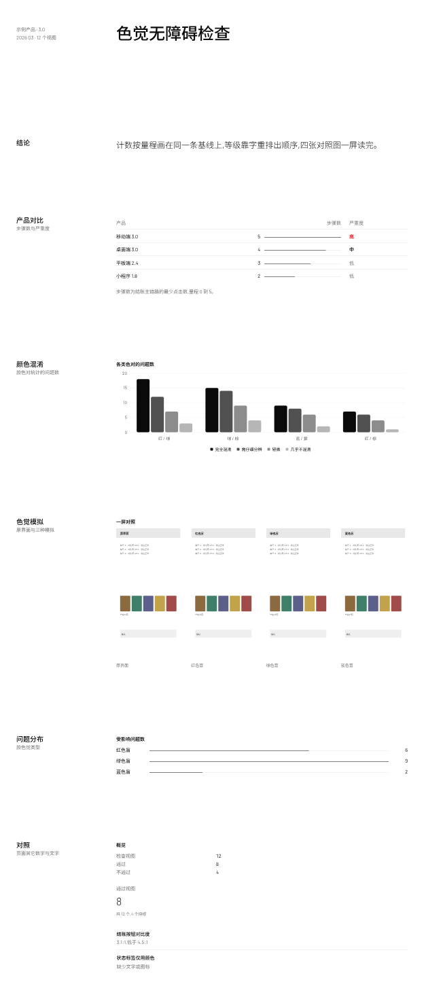

# 组件改动 k8(待审,第 1 版)

组件 Agent 做出的示例,合并前需要人工审批:
- 通过:`node scripts/component-loop.mjs approve k8`
- 写意见让 Agent 再改一版:`node scripts/component-loop.mjs revise k8 "意见"`
- 自己改代码:直接改 `traces/_components/k8/app/`,改完再 approve
- 不采用:`node scripts/component-loop.mjs reject k8 "原因"`

## 示例效果

演示页用组件 Agent 自造的测试数据,新部件和一小段现有组件放在同一页:



切块截图在 `traces/_components/k8/tile-*.png`。

## 组件 Agent 的说明

我完成了这轮工作。下面是说明。

## 结论

对着需求逐条核了一遍当前组件库，**六条里四条（bar、levels、ProgressList、Section 顶对齐）在当前库里已经成立**，我实测确认了；真正缺的是两条：**BarChart 的多系列默认配色**和 **FigureCompare 的排版**。这轮改的就是这两处。

## 新部件

这轮**没有新增部件**，缺的能力落在两个已有部件里，改的是它们：

| 部件 | 位置 | 管什么 | 来自 |
|---|---|---|---|
| `BarChart`（`chartConfig` / `seriesInk` / `legendOrder`） | `app/src/components/report/render.tsx` | 多系列柱状图/折线图的系列取色与图例顺序 | shadcn `chart`（recharts `ChartContainer`/`ChartLegend`） |
| `FigureCompare` | `app/src/components/report/index.tsx` | 四张对照图（原界面 + 三种色觉模拟）的排布 | 自己组合，图本身用 `Figure`/`FigureImage`/`FigureLabel` |

### 1. BarChart 的系列色（需求 3）

原来是 `var(--chart-1..5)`（橙、青、深蓝、黄，就是证据里写的那四种高饱和色）。现在系列改成**一条墨阶**：第一个系列 `var(--foreground)`，其余按 `color-mix(in oklab, var(--foreground) 66%/42%/26%, var(--background))` 依次变浅——纯灰阶，图表不再是全页最重的一块，红色仍然只留给判定。灰阶从页面自己的 token 混出来，不另起一套调色板。

顺带修了图例顺序：recharts 3 的 `Legend` 默认 `itemSorter: 'value'`，而 Bar 的 `value` 就是 `dataKey`，所以图例是按 dataKey 字母序排的——墨阶会被打乱（实测出现「完全混淆 / 需仔细分辨 / **几乎不混淆** / 轻微」）。现在给 `ChartLegend` 传 `itemSorter={legendOrder(series)}`，图例按系列声明顺序排，灰阶读起来才是从深到浅。

### 2. FigureCompare（需求 4）

原来是 `grid-cols-2` + 图高封在 `max-h-64`：375×760 的长截图被压成 **126px 宽**的一条细缝，两行两列又每屏只放得下两张，第二行要滚动才看得到（截图见证据 c2/c3/c4）。

现在改成**一行四张**：`grid-cols-4`，每张占列宽的四分之一、按原比例缩放，高度只封一个上限（`max-h-96`，只为了防止极长截图把整组顶出屏幕）；图注仍占满整格宽。`self-start` 是必须的——`Figure` 是 flex 列容器，默认 `align-items: stretch` 会把 `width:auto` 的图拉回整格宽（不写就会把图拉变形）。实测同一组长截图：**189×384，一行 416px 高**，比原来的 126×256、两行 584px 又大又短，整组一屏读完。要看图内细节（宽的分析视图）仍用 `FigureGrid`。

## 演示页与验证

`Page.tsx` 按需求六个场景各放一节（产品对比表 / 颜色混淆柱状图 / 色觉模拟四图 / 问题分布 / 对照），图片是自造的 4 张 375×760 SVG 放在 `assets/`。`node $SHOOT .` 三次运行，程序检查全过（`checks.json` 为 `[]`）。实测：

- bar：步骤数列 5/4/3/2 → 条长 100%/80%/60%/40%，墨线在浅灰基线上，末端可辨；
- levels：高 = destructive/600、中 = 600、低 = muted-foreground/400，三级可排序；
- ProgressList：6/9/2 → 67%/100%/22%，条按列表量程画在同一条基线上；
- Section：六个节的标题顶边与内容顶边 **delta 全为 0**，无垂直居中。

## 需求里哪些没做 / 为什么

- **需求 1、2、5、6 我没有改代码**：当前组件库里已经满足（`ui/progress.tsx` 的基线 + 墨线、`render.tsx` 的 `step()` 三级字重、`progress-list` 的按列表最大值定量程、`Section` 的 `items-start`）。`requests.json` 里这几条的 evidence（「细横线与表格行线同色同粗」「只有高标红」「三条横线等长 1、1、1」「标题相对 2×2 图垂直居中」）描述的是更早一版渲染出来的页面，和现在的实现对不上，所以我按「不改和需求无关的地方」处理，只在演示页里把它们摆出来验证。
- **一处没做**：FigureCompare 对**宽**截图（1200×760）会比两行两列小（196px 宽 vs 原来的 404px）。四张同屏 + 每张尽量大，在 858px 内容列宽下和「宽图也能看清图内文字」不可兼得，而需求点名的是「截图比例偏长」的情况，所以我按长截图取最优；宽图要看细节由 `FigureGrid` 承担（2 列铺满列宽，行高不限）。如果要把两种比例都做到最优，需要让 FigureCompare 在运行时读图片原始比例来定列数，那要引入测量状态，和「几个可组合的小部件」的写法不符，我没有做。

## 改了哪些已有组件（按要求列出）

| 文件 | 改动 | 原因 |
|---|---|---|
| `app/src/components/report/render.tsx` | 删掉 `CHART_COLORS`，加 `SERIES_INK_STEPS`/`seriesInk()`；`chartConfig` 用墨阶；加 `legendOrder()`，两处 `ChartLegend` 传 `itemSorter` | 需求 3；图例乱序会让墨阶读反 |
| `app/src/components/report/index.tsx` | `FigureCompare` 从 `grid-cols-2` + `max-h-64` 改为 `grid-cols-4` + `max-h-96`，图片加 `w-auto`/`self-start`/`max-w-full` | 需求 4 |
| `components.md` | 更新 `BarChart`、`FigureCompare`、`FigureImage` 三行和「模拟视图」段落 | 文档跟代码一致 |

`app/src/components/ui/` 和 `app/src/index.css` 没动；`shadcn/ui/` 只读参考，没动。

## 需求(Maintainer 归纳的「组件不够」问题,6 条)

- **交互流程挖掘 P-15**(审美 judge,f2):DataTable 的 bar 条与表格行线同色同粗，使产品对比表的步骤数列分不出数量差别。
- **交互流程挖掘 P-21**(审美 judge,f2):DataTable 的 levels 除最高一级外没有可辨的强度差别，使问题明细表的严重度列只有「高」一级读得出来，中、低两级与正文没有视觉区别。
- **色觉无障碍分析 P-02**(审美 judge,c3):BarChart 的多系列默认配色用色多、饱和度高，使颜色混淆一节的柱状图成为全页视觉重量最大的一块，抢走结论的注意力。
- **色觉无障碍分析 P-12**(审美 judge,c2、c3、c4):FigureCompare 的每格图高固定、图注又各占一行，使截图比例偏长的报告里四张对照图仍被拉成上下两屏，后一屏只剩两张图与两个图注，读者无法在一屏内完成对照。
- **色觉无障碍分析 P-15**(审美 judge,c3、c4):ProgressList 的条是发丝细线或等长虚线、不带基线或刻度，条目标签还带多种颜色，使「按色觉类型的问题数」一栏既看不出数值差异、说不出这条线的作用，也与页面其它数字的呈现方式不一致。
- **色觉无障碍分析 P-24**(审美 judge,c1):Section 的节标题相对内容垂直居中，使同一页里各节的标题有的顶对齐、有的居中，读者对不齐各节的起始线、看不出内容的分组。

## 检查

演示页程序检查:
无问题

组件代码检查(已有代码和 tokens 不改;新增代码只用 token、规范的字号,无阴影和底色;从 shadcn 复制来的文件也查):
无问题

## 改动

```diff
diff --git a/src/components/report/index.tsx b/src/components/report/index.tsx
index b4be742..190ecd0 100644
--- a/src/components/report/index.tsx
+++ b/src/components/report/index.tsx
@@ -144,20 +144,24 @@ export function FigureGrid({ className, children, ...props }: React.ComponentPro
 
 // The comparison set for colour vision (the interface plus its simulations) has
 // to be read as one group: all four views together, at a size where what is
-// inside them still reads, and the whole group inside one screen. Two columns
-// give the width (a quarter of the content column would be a thumbnail); the
-// images keep their own ratio and are capped at one height, so the group is
-// always two bounded rows whatever the screenshots' proportions are, and a tall
-// screenshot is not stretched into a second screen. The caption runs the width
-// of its cell, so a narrow view does not wrap its label into a column of lines.
+// inside them still reads, and the whole group inside one screen. Four to a row
+// is what does that: the content column is wide enough for four views, and one
+// band of four is shorter than two bands of two. The earlier two-by-two put two
+// views per screen — the second band fell past the fold, so the reader never had
+// the four side by side — and the fixed cell height it needed turned a long
+// screenshot into a narrow sliver with the band half empty. Here each view takes
+// a quarter of the row and keeps its own ratio; the height is capped only so a
+// very long screenshot cannot push the group past the screen, and the caption
+// runs the width of its cell, so a narrow view does not wrap its label into a
+// column of lines.
 export function FigureCompare({ className, children, ...props }: React.ComponentProps<"div">) {
   return (
     <div
       data-slot="figure-compare"
       className={cn(
-        "grid w-full grid-cols-2 gap-x-6 gap-y-6",
+        "grid w-full grid-cols-4 gap-x-6 gap-y-6",
         "[&>[data-slot=figure]]:w-full [&>[data-slot=figure]]:min-w-0",
-        "[&_[data-slot=figure-image]]:max-h-64 [&_[data-slot=figure-image]]:w-auto [&_[data-slot=figure-image]]:max-w-full",
+        "[&_[data-slot=figure-image]]:h-auto [&_[data-slot=figure-image]]:w-auto [&_[data-slot=figure-image]]:self-start [&_[data-slot=figure-image]]:max-w-full [&_[data-slot=figure-image]]:max-h-96",
         className
       )}
       {...props}
diff --git a/src/components/report/render.tsx b/src/components/report/render.tsx
index acbfcdb..a267fd2 100644
--- a/src/components/report/render.tsx
+++ b/src/components/report/render.tsx
@@ -91,13 +91,23 @@ const SPAN = [
   "col-span-12",
 ]
 
-const CHART_COLORS = [
-  "var(--chart-1)",
-  "var(--chart-2)",
-  "var(--chart-3)",
-  "var(--chart-4)",
-  "var(--chart-5)",
-]
+// Series colours. A chart on a report page is evidence under a verdict, not the
+// page's subject: a palette of four saturated hues made the chart the heaviest
+// block on the page and pulled the eye off the conclusion, and it fought the
+// page's black-and-grey with one red mark. So a series is drawn in ink, not in
+// colour: the first series at full strength and the rest stepping down through
+// greys. The order is still readable in greyscale print and to a colour-blind
+// reader, the chart's weight stays below the conclusion's, and red is left to
+// the verdict alone. The steps are mixed from the page's own tokens, so they
+// follow the theme instead of being a second palette beside it.
+const SERIES_INK_STEPS = [100, 66, 42, 26]
+
+function seriesInk(i: number) {
+  const pct = SERIES_INK_STEPS[i] ?? Math.max(8, 26 - (i - SERIES_INK_STEPS.length + 1) * 6)
+  return pct >= 100
+    ? "var(--foreground)"
+    : `color-mix(in oklab, var(--foreground) ${pct}%, var(--background))`
+}
 
 type Ctx = { span?: number; rows?: number }
 
@@ -118,11 +128,19 @@ type Series = { key: string; label: string }
 function chartConfig(series: Series[]): ChartConfig {
   const cfg: ChartConfig = {}
   series.forEach((s, i) => {
-    cfg[s.key] = { label: s.label, color: CHART_COLORS[i % CHART_COLORS.length] }
+    cfg[s.key] = { label: s.label, color: seriesInk(i) }
   })
   return cfg
 }
 
+// The legend lists the series in the order they are drawn, which is the order
+// the ink steps down: darkest first. Recharts' default sorter is the data key,
+// which shuffles an ordered palette, so the reader would see the greys out of
+// order and read the ramp backwards.
+function legendOrder(series: Series[]) {
+  return (item: { dataKey?: unknown }) => Math.max(0, series.findIndex((s) => s.key === item.dataKey))
+}
+
 export function Node({ node, ctx = {} }: { node: SpecNode; ctx?: Ctx }) {
   const p = node as Record<string, any>
   const frame = React.useContext(FrameContext)
@@ -502,7 +520,7 @@ export function Node({ node, ctx = {} }: { node: SpecNode; ctx?: Ctx }) {
                     <YAxis tickLine={false} axisLine={false} width={40} />
                   </>
                 )}
-                {series.length > 1 && <ChartLegend content={<ChartLegendContent />} />}
+                {series.length > 1 && <ChartLegend content={<ChartLegendContent />} itemSorter={legendOrder(series)} />}
                 {series.map((s) => (
                   <Bar key={s.key} dataKey={s.key} fill={`var(--color-${s.key})`} radius={4} isAnimationActive={false} />
                 ))}
@@ -524,7 +542,7 @@ export function Node({ node, ctx = {} }: { node: SpecNode; ctx?: Ctx }) {
                 <XAxis dataKey={p.xKey} tickLine={false} axisLine={false} tickMargin={8} fontSize={12} />
                 {/* a trend reads by its slope, so the axis fits the data range instead of starting at 0 */}
                 <YAxis tickLine={false} axisLine={false} width={32} fontSize={12} domain={[yTicks[0], yTicks[yTicks.length - 1]]} ticks={yTicks} interval={0} />
-                {series.length > 1 && <ChartLegend content={<ChartLegendContent />} />}
+                {series.length > 1 && <ChartLegend content={<ChartLegendContent />} itemSorter={legendOrder(series)} />}
                 {series.map((s) => (
                   <Line key={s.key} dataKey={s.key} stroke={series.length > 1 ? `var(--color-${s.key})` : "var(--primary)"} strokeWidth={2} dot={{ r: 3, fill: "var(--background)", strokeWidth: 2 }} isAnimationActive={false} />
                 ))}
diff --git a/components.md b/traces/_components/k8/components.md
index 4b14d58..cbf4871 100644
--- a/components.md
+++ b/traces/_components/k8/components.md
@@ -31,7 +31,7 @@ import { Page, Section, Group, Grid, Block, Text, Stat, DataTable, TrendChart, B
 | `Stat` | `value`, `label?`, `unit?`, `size?: "lg" \| "xl"`, `captionBelow?`, `quiet?`, `note?`, `delta?`, `direction?: "up" \| "down"` | 一个数字。默认 30px,`lg` 48px 细体。`captionBelow` 把 `label` 放在数字下面。`note` 是一行 12px 注释;`direction: "down"` 且没有 `delta` 时注释为红色 |
 | `DataTable` | `columns`, `rows`, `caption?` | 表格。`columns` 每项:`key`, `label`, `align?: "right"`, `span?`(占几列网格,写了就按网格定列宽;一行的 `span` 加起来 9 正好铺满内容列), `bar?`(数字后接计数条:1px 墨线画在一条 1px 基线上,基线与量程等宽、与表格行线同宽同色,条长是该值与同列最大值的比。条用墨色、行线用浅灰,所以条的末端一眼可辨,不会被误读成一条说不出作用的行线), `tone?: string[]`(这些值标红**并加粗**(正文 400 → 600)——红色在灰度打印里比黑字还浅,色弱读者也看不出红,所以状态必须有一个颜色之外的通道,字重就是它), `levels?: string[]`(一列有序的等级,从低到高排。最高一级标红并加粗,次一级加粗,再往下用注释灰:三级都与正文有区别,读者能把严重度排出顺序,而不是只有「高」有颜色、中低两级和正文没有视觉区别), `muteWhen?: {key, equals}`(行灰显), `interval?: {low, high, domain: [min, max]}`(画区间图)。`caption` 是表格**下方**一行灰色小字注释(如口径、阈值说明),左对齐,与表格左边缘齐平;不是表名,表名用外面 `Group` 的 `title` |
 | `TrendChart` | `data`, `xKey`, `series: {key, label}[]`, `height?`, `band?: {low, high}`, `zero?`, `yTicks?`, `xInterval?`, `pointLabels?: "last"`, `lastLabel?` | 折线图。`height` 用 `"h-48"` 之类,或 `"fill"` 填满所在块 |
-| `BarChart` | `data`, `xKey`, `series`, `layout?: "horizontal"` | 柱状图;`horizontal` 是横向细条 |
+| `BarChart` | `data`, `xKey`, `series`, `layout?: "horizontal"` | 柱状图;`horizontal` 是横向细条。多个系列用一条从黑到浅灰的墨阶:第一个系列最重,依次变浅,图例也按这个顺序排。图表是结论下面的证据,不是页面的主角,所以不另起一套彩色(彩色会把图变成全页最重的一块,还会和只表示判定的红色混在一起) |
 | `ProgressList` | `items: {label, value, max?, display?}[]`, `compact?` | 进度条列表;`compact` 每行依次是名称、条、数值。条是 1px 墨线画在一条 1px 基线上:基线与量程(0 到 `max`)等宽、与页面其它细线同宽同色,条长是计数与满值之比,所以同一列表里的数值差异由长度给出,而不是靠颜色,也不会比页面其它细线粗。`max` 不给时取列表里的最大值,所以小计数(6、9、2)也铺满各自的比例,不会都缩成等长的发丝细线;数值用和页面其它数字一致的等宽数字 |
 | `List` | `items: {title?, description?, meta?}[]`, `numbered?`, `ordered?`, `columns?`, `divided?`, `metaTone?: "destructive"` | 列表。`numbered` 带 01、02 序号和行间细线;`columns` 并排;`ordered` 带 1、2 序号 |
 | `KV` | `items: {label, value}[]`, `labelCols?` | 键值表;`labelCols` 让标签占几列网格 |
@@ -45,9 +45,9 @@ import { Page, Section, Group, Grid, Block, Text, Stat, DataTable, TrendChart, B
 |---|---|---|
 | `FigureStrip` | children | 一行截图,放在 shadcn `ScrollArea` 里横向滚动,滚动条是 shadcn 的样式(不是浏览器原生滚动条),只在鼠标悬停时出现,静止时不占地方也不画横条;超出宽度的部分裁掉,不把页面撑宽。行高由这条自己定:所有图同高、宽度各按原比例,所以手机 375×760 和分析图 1200×760 能并排对齐 |
 | `FigureGrid` | children | 一版对照图,两列铺满内容列宽,每格一张 `Figure`;图按列宽显示、高度随原比例,用于要看清图内细节的对照,行高不限 |
-| `FigureCompare` | children | 一组四张的对照图(原界面 + 三种色觉模拟),2×2 铺满内容列宽,每张图按原比例缩放到同一个高度上限(`max-h-64`),所以不管截图比例多长,整组都是两行、一屏内读完,不会因为图高按列宽走而被拉成上下两屏;每格的图注占满整格宽,窄图的长图注不会折成多行把整组撑高 |
+| `FigureCompare` | children | 一组四张的对照图(原界面 + 三种色觉模拟),一行四张铺满内容列宽。四张并排是一屏能读完的最短排法:内容列宽正好放四张,一行比两行两列少占一半高度,四张始终在同一屏里,可以直接横向比。每张图占行的四分之一、按原比例缩放,高度只封一个上限(`max-h-96`),所以再长的截图也不会把这一组顶出屏幕;每格的图注占满整格宽,窄图的长图注不会折成多行把整组撑高。要看图内细节(宽的分析视图)用 `FigureGrid`,不在这里把图放大成两行 |
 | `Figure` | children | 一张截图的外框,纵向排图、标签和说明;宽度随所在布局,不收缩 |
-| `FigureImage` | `src`, `alt` | 截图本体。宽度随所在布局、高度随原比例,自己不定高(定高的是容器):在 `FigureStrip` 里由条给统一高度(比例不同的图才对得齐),在 `FigureGrid` 里铺满所在列宽(图内文字才看得清),在 `FigureCompare` 里由格给统一高度、宽随比例。不裁剪 |
+| `FigureImage` | `src`, `alt` | 截图本体。宽度随所在布局、高度随原比例,自己不定高(定高的是容器):在 `FigureStrip` 里由条给统一高度(比例不同的图才对得齐),在 `FigureGrid` 里铺满所在列宽(图内文字才看得清),在 `FigureCompare` 里占行宽的四分之一、高度封在上限内(四张同屏)。不裁剪 |
 | `FigureLabel` | children(字符串) | 图下面或上面的视图名(屏名、步号),12px 灰色 |
 | `FigureText` | children(字符串) | 图下面的说明(内容、操作、输入项),14px 正文 |
 
@@ -70,9 +70,9 @@ import { Page, Section, Group, Grid, Block, Text, Stat, DataTable, TrendChart, B
 </Group>
 ```
 
-模拟视图:一组四张(原界面 + 三种色觉模拟),每张带视图名,两列铺满内容列宽;要放说明文字就用 `Block` 的 `title`/`description` 包住这一组。`FigureLabel` 放在 `FigureImage` 前就是名称在上,放在后就是名称在下。
+模拟视图:一组四张(原界面 + 三种色觉模拟),每张带视图名;要放说明文字就用 `Block` 的 `title`/`description` 包住这一组。`FigureLabel` 放在 `FigureImage` 前就是名称在上,放在后就是名称在下。
 
-用 `FigureGrid` 时每张图按列宽显示,行高随图片比例,图片很高时一组会超出一屏;四张要在一屏内读完就用 `FigureCompare`:它把每张图的高度封在同一个上限上,所以不管截图比例多长,整组都是两行。
+用 `FigureGrid` 时每张图按列宽显示,行高随图片比例,图片很高时一组会超出一屏;四张要在一屏内读完就用 `FigureCompare`:四张并排成一行,各占四分之一列宽,高度封在同一个上限内。这样整组只占一条,比两行两列矮一半,四张始终同屏、可以直接横向比;两行两列的排法每屏只放得下两张,第二行的两张要滚动才看得到,不成为一组对照。
 
 ```tsx
 <Group title="色觉模拟">

```
